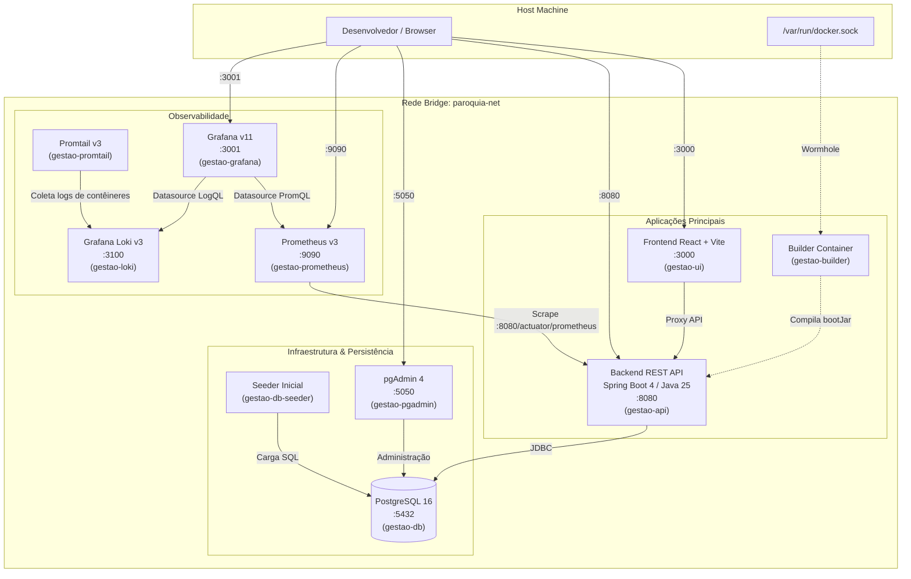

# Arquitetura e Guia Docker - Paróquia

Este documento descreve a infraestrutura de contêineres, orquestração e ferramentas de desenvolvimento do projeto **Paróquia**.

---

## 1. Visão Geral da Arquitetura

O ambiente em contêineres é gerenciado via **Docker Compose** e isolado na rede bridge personalizada `paroquia-net`. Os serviços cobrem o ciclo completo de desenvolvimento, desde a compilação e execução até o monitoramento e observabilidade em tempo real.



---

## 2. Tabela de Serviços e Portas

| Serviço | Contêiner | Imagem Base | Porta Host | Finalidade | Credenciais Padrão |
| :--- | :--- | :--- | :--- | :--- | :--- |
| **ui** | `gestao-ui` | `node:22-alpine` | `3000` | Interface SPA (React + Vite) | `admin` / `senha123` |
| **api** | `gestao-api` | `eclipse-temurin:25-jre-alpine` | `8080` | Backend REST API (Spring Boot) | N/A |
| **db** | `gestao-db` | `postgres:16-alpine` | `5432` | Banco de Dados Relacional | `postgres` / `password` (DB: `calendario`) |
| **builder** | `gestao-builder` | `eclipse-temurin:25-jdk-alpine` | N/A | Build e execução de Testcontainers | Usuário interno: `dev` |
| **db-seeder** | `gestao-db-seeder` | `postgres:16-alpine` | N/A | Inicialização de dados locais | `postgres` / `password` |
| **pgadmin** | `gestao-pgadmin` | `dpage/pgadmin4:9.1` | `5050` | Gerenciador Web do Postgres | `admin@paroquia.local` / `admin` |
| **prometheus**| `gestao-prometheus`| `prom/prometheus:v3.2.1` | `9090` | Coletor TSDB de métricas | N/A |
| **grafana** | `gestao-grafana` | `grafana/grafana:11.5.2` | `3001` | Painéis e Dashboards analíticos | `admin` / `admin` |
| **loki** | `gestao-loki` | `grafana/loki:3.2.1` | `3100` | Agregação e Armazenamento de Logs | N/A |
| **promtail** | `gestao-promtail` | `grafana/promtail:3.2.1` | N/A | Coletor e remetente de logs para Loki | N/A |

---

## 3. Padrão Docker Wormhole (Builder + Testcontainers)

Para suportar testes automatizados de integração que sobem bancos de dados reais sem necessidade de Docker-in-Docker (DinD privilegiado), o contêiner `gestao-builder` utiliza o padrão **Docker-out-of-Docker (DooD / Wormhole)**:

1. O socket do Docker do host (`/var/run/docker.sock`) é montado no contêiner `gestao-builder`.
2. O script [`docker/scripts/builder-entrypoint.sh`](file:///home/bruno-luiz-viana/DEV/WORKSPACE/JAVA/paroquia/docker/scripts/builder-entrypoint.sh) detecta dinamicamente o GID numérico do socket do host, cria um grupo compatível dentro do contêiner e associa o usuário `dev`.
3. O comando do Gradle ou Testcontainers é executado via `gosu dev`, permitindo que os testes instanciem contêineres irmãos diretamente no daemon Docker do hospedeiro, sem executar código como `root`.

---

## 4. Volumes Persistentes

O ecossistema utiliza volumes nomeados para isolamento e reaproveitamento de caches:

- `paroquia_postgres_data`: Diretório de dados persistentes do PostgreSQL (`/var/lib/postgresql/data`).
- `paroquia_shared_volume`: Compartilhamento do artefato `app.jar` compilado pelo builder para o runtime da API.
- `paroquia_gradle_cache`: Cache persistente de dependências do Gradle (`/root/.gradle`).
- `paroquia_prometheus_data`: Armazenamento de séries temporais do Prometheus (`/prometheus`).
- `paroquia_grafana_data`: Configurações de usuários e preferências do Grafana (`/var/lib/grafana`).

---

## 5. Rotação de Logs e Segurança

- **Rotação de Logs:** Todos os serviços utilizam o driver `json-file` configurado com `max-size: 10m` e `max-file: 3`, prevenindo esgotamento de espaço em disco em ambientes de longa execução.
- **Princípio do Menor Privilégio (Não-Root):**
  - O contêiner de API roda sob o usuário sem privilégios `appuser` (`appgroup`).
  - O contêiner de UI roda sob o usuário padrão `node`.
- **Governança de Recursos (Teto de 30% da Máquina):** O processo de build está estritamente limitado a no máximo 30% da capacidade do host: 3 núcleos de CPU (`cpus: '3.0'`, `org.gradle.workers.max=3`) e 4GB de RAM (`mem_limit: 4096M`, `-Xmx1536m`), garantindo que pelo menos 70% dos recursos permaneçam livres e dedicados ao sistema operacional.

---

## 6. Comandos e Operação

O gerenciamento é realizado pelos scripts canônicos:

### Usando o `docker-env.sh` (Focado no ciclo Docker)

```bash
# Subir todo o ambiente em segundo plano
./docker-env.sh up

# Subir com reconstrução forçada sem cache
./docker-env.sh up --no-cache

# Reiniciar ambiente com limpeza total de volumes de dados
./docker-env.sh restart --clean

# Exibir status detalhado e consumo de memória/CPU
./docker-env.sh status

# Acompanhar logs de um serviço específico
./docker-env.sh logs -f -s api

# Derrubar contêineres mantendo dados
./docker-env.sh down
```

### Usando o `manage.sh` (CLI Unificada)

```bash
# Iniciar infraestrutura Docker + rodar API e UI localmente
./manage.sh dev

# Parar todos os processos locais e contêineres
./manage.sh stop

# Executar quality gates rigorosos (Checkstyle, PMD, SpotBugs, ArchUnit)
./manage.sh check

# Executar suíte de testes
./manage.sh test

# Limpar caches de build
./manage.sh clean
```

---

## 7. Resolução de Problemas (Troubleshooting)

### Porta em uso (ex: 5432, 8080 ou 3000)
Verifique se há outro PostgreSQL ou aplicação rodando localmente:
```bash
sudo lsof -i :5432 -i :8080 -i :3000
```
Encerre os processos conflitantes antes de executar `./docker-env.sh up`.

### Permissão no socket Docker
Se o contêiner builder falhar ao acessar o daemon Docker, certifique-se de que o usuário do host faz parte do grupo `docker`:
```bash
sudo usermod -aG docker $USER
newgrp docker
```

### Limpeza Completa e Redefinição
Para resetar completamente o ecossistema Docker (excluindo volumes, imagens órfãs e redes):
```bash
./docker-env.sh clean
```
