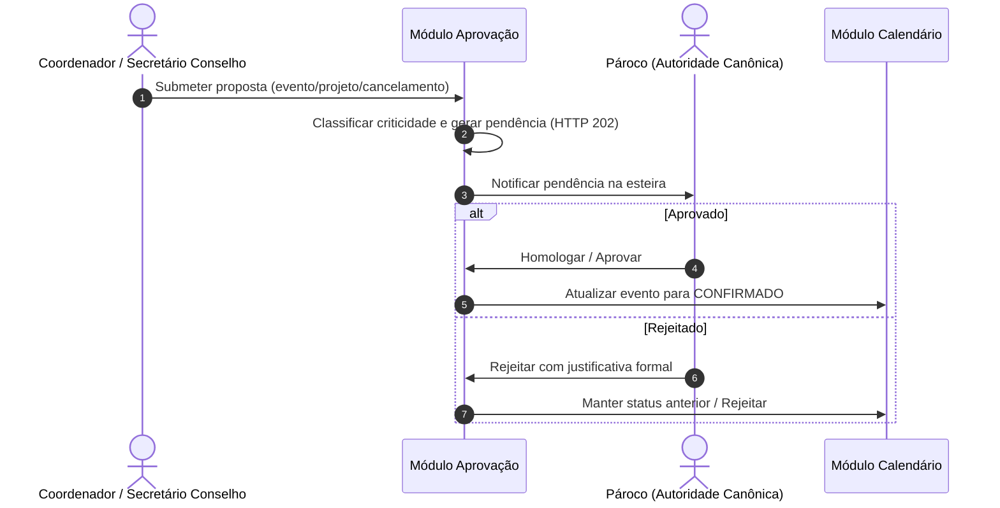

# Regras de Negócio e Fluxos: Módulo Aprovações (`aprovacao`)

O módulo de Aprovações centraliza a governança decisória da paróquia sobre alterações de agenda, eventos extraordinários e projetos, estabelecendo esteiras de deliberação por níveis de alçada e criticidade sob autoridade canônica do Pároco.

---

## 1. Visão Geral e Propósito
Assegurar que nenhuma alteração de impacto pastoral, litúrgico ou patrimonial ocorra sem a deliberação formal da autoridade competente (Pároco ou Bispo Diocesano), transformando propostas em atos aprovados.

---

## 2. Agregados, Entidades e Value Objects Principais
- **`SolicitacaoAprovacao` (Raiz de Agregado):** Identificada por `SolicitacaoAprovacaoId`. Armazena o tipo de solicitação, o recurso alvo, solicitante (`UsuarioId`), justificativa formal e histórico de decisões.
- **`TipoSolicitacao` (Enum):** `CRIACAO_EVENTO`, `EDICAO_EVENTO`, `CANCELAMENTO_EVENTO`, `CRIACAO_PROJETO`, `ALOCACAO_EXTRAORDINARIA`.
- **`StatusAprovacao` (Enum):** `PENDENTE`, `APROVADO`, `REJEITADO`, `CANCELADO_PELO_SOLICITANTE`.
- **`AprovadorPapel` (Enum):** `PAROCO` (única alçada ordinária canônica homologatória).

---

## 3. Regras de Negócio Invariantes

### RN-APR-01: Alçada Canônica Exclusiva do Pároco
- A decisão final e homologação de solicitações é **competência privativa do Pároco** (`AprovadorPapel.PAROCO` / `ROLE_GLOBAL_PAROCO`).
- Conselhos pastorais e coordenadores de pastoral podem propor, redigir e solicitar aprovação, mas **não possuem voto deliberativo** nem podem aprovar solicitações na esteira.
- O perfil `ADMIN` é estritamente bloqueado de tomar decisões de aprovação eclesial.

### RN-APR-02: Justificativa Mandatória na Rejeição
- Toda recusa ou rejeição de solicitação **DEVE conter parecer textual fundamentado**, indicando os motivos pastorais, litúrgicos ou de planejamento.

### RN-APR-03: Fila de Urgência Baseada em Proximidade
- Solicitações cuja data de início do evento esteja a menos de 48 horas recebem classificação `URGENTE`, com destaque visual no topo das esteiras.

---

## 4. Fluxos Operacionais e Casos de Uso

---

## 5. Integrações com outros Bounded Contexts
- **`calendario`:** Mudança de estado do evento (`CONFIRMADO`, `PENDENTE`, `CANCELADO`).
- **`iam`:** Verificação estrita de que apenas o Pároco decide aprovações.
