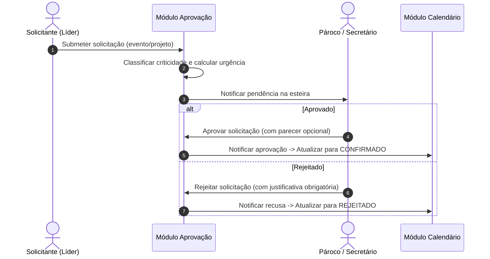

# Regras de Negócio e Fluxos: Módulo Aprovações (`aprovacao`)

O módulo de Aprovações centraliza a governança decisória da paróquia sobre alterações de agenda, eventos extraordinários e projetos, estabelecendo esteiras de deliberação por níveis de alçada e criticidade.

---

## 1. Visão Geral e Propósito
Assegurar que nenhuma alteração de impacto pastoral, litúrgico ou patrimonial ocorra sem a anuência das autoridades competentes (Pároco, Vigários Paroquiais ou Conselho Pastoral/Econômico).

---

## 2. Agregados, Entidades e Value Objects Principais
- **`SolicitacaoAprovacao` (Raiz de Agregado):** Identificada por `SolicitacaoAprovacaoId`. Armazena o tipo de solicitação, o identificador do recurso alvo (evento, projeto), o solicitante (`UsuarioId`), a data de submissão, a justificativa e o histórico de decisões.
- **`TipoSolicitacao` (Enum):** `CRIACAO_EVENTO`, `EDICAO_EVENTO`, `CANCELAMENTO_EVENTO`, `CRIACAO_PROJETO`, `ALOCACAO_EXTRAORDINARIA`.
- **`StatusAprovacao` (Enum):** `PENDENTE`, `APROVADO`, `REJEITADO`, `CANCELADO_PELO_SOLICITANTE`.
- **`NivelCriticidade` (Enum):** `BAIXA`, `MEDIA`, `ALTA`, `URGENTE`.
- **`DecisaoAprovacao` (Value Object):** Decisão tomada (`APROVAR` ou `REJEITAR`), aprovador (`UsuarioId`), justificativa formal e timestamp UTC.

---

## 3. Regras de Negócio Invariantes

### RN-APR-01: Alçadas de Decisão
- Solicitações de eventos litúrgicos (missas solenes, festas de padroeiro) exigem aprovação exclusiva de clérigo com papel `PAROCO` ou `VIGARIO`.
- Solicitações pastorais comuns podem ser aprovadas pelo Secretário Paroquial ou Coordenador Geral caso delegado expressamente pelo Pároco.

### RN-APR-02: Justificativa Mandatória na Rejeição
- Toda recusa ou rejeição de solicitação **DEVE OBRIGATORIAMENTE conter parecer/justificativa textual**, indicando o motivo canônico, pastoral ou de infraestrutura que fundamentou a negativa.

### RN-APR-03: Fila de Urgência Baseada em Proximidade
- Solicitações cuja data de início do evento esteja a menos de 48 horas da data atual recebem a classificação `URGENTE`, recebendo destaque prioritário visual no topo das esteiras do painel e do módulo.

### RN-APR-04: Apresentação Sintética no Painel (Dashboard)
- Na tela principal do Painel (`dashboard`), o quadro de Aprovações Pendentes deve exibir **apenas o agrupamento de quantidades por tipo de solicitação** (com ícone semântico, rótulo e badge numérico) e o botão direto para o módulo de aprovações, sem detalhes individuais para manter a densidade visual limpa.

---

## 4. Fluxos Operacionais e Casos de Uso

---

## 5. Integrações com outros Bounded Contexts
- **`calendario`:** Mudança de estado do evento (`CONFIRMADO`, `REJEITADO`, `CANCELADO`).
- **`projeto`:** Validação de solicitações de criação de novos projetos ou ampliação de orçamento/escopo.
- **`iam`:** Verificação estrita das permissões de autorização do usuário aprovador.
