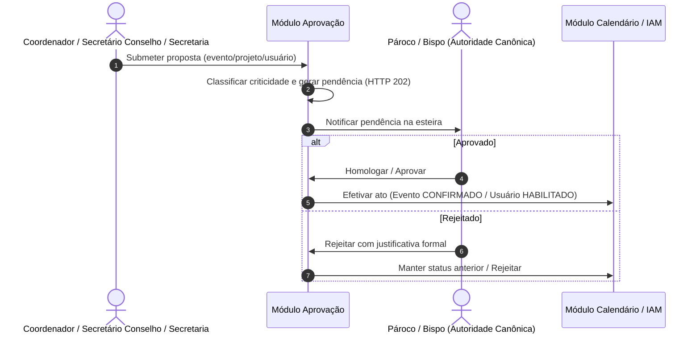

# Regras de Negócio e Fluxos: Módulo Aprovações (`aprovacao`)

O módulo de Aprovações centraliza a governança decisória da paróquia sobre alterações de agenda, eventos extraordinários e projetos, estabelecendo esteiras de deliberação por níveis de alçada e criticidade sob autoridade canônica do Pároco.

---

## 1. Visão Geral e Propósito
Assegurar que nenhuma alteração de impacto pastoral, litúrgico ou patrimonial ocorra sem a deliberação formal da autoridade competente (Pároco ou Bispo Diocesano), transformando propostas em atos aprovados.

---

## 2. Agregados, Entidades e Value Objects Principais
- **`Aprovacao` (Raiz de Agregado):** identificada por UUID. Armazena o evento alvo, o tipo da solicitação, o solicitante, a justificativa, o papel do aprovador, o payload da ação a executar, o identificador de correlação, as datas de criação, decisão e execução, a observação da decisão, os conflitos de agenda apurados e, quando a ação falha, a mensagem e o tipo da falha. Pode ter uma aprovação-mãe: a decisão da mãe é propagada às filhas.
- **`TipoSolicitacaoInput` (Enum):** `CRIACAO_EVENTO`, `EDICAO_EVENTO`, `ALTERACAO_HORARIO`, `CANCELAMENTO`, `RECLASSIFICACAO`, `ALOCACAO_ATIVO_EMPRESTIMO`, `OUTRO`.
- **`AprovacaoStatus` (Enum):** `PENDENTE`, `APROVADA`, `REPROVADA`, `FALHA_EXECUCAO`. A máquina de estados é `PENDENTE → APROVADA | REPROVADA`; sobre `APROVADA` registra-se a execução, ou `FALHA_EXECUCAO`.
- **`TipoFalhaAprovacao` (Enum):** `NEGOCIO_CADASTRAL` e `SISTEMICA_APLICACAO`. Só a falha sistêmica admite reexecução.
- **`AprovadorPapel` (Enum):** `PAROCO` (alçada ordinária canônica homologatória) e `BISPO_DIOCESANO` (autoridade superior, com a mesma alçada decisória).

---

## 3. Regras de Negócio Invariantes

### RN-APR-01: Alçada Canônica do Pároco e do Bispo Diocesano
- A decisão final e homologação de solicitações é **competência do Pároco** (`ROLE_GLOBAL_PAROCO`) e do **Bispo Diocesano**, autoridade superior com a mesma alçada decisória; a divergência anterior da documentação (alçada só do Pároco) foi resolvida em favor do comportamento vigente do sistema.
- Conselhos pastorais e coordenadores de pastoral podem propor, redigir e solicitar aprovação, mas **não possuem voto deliberativo** nem podem aprovar solicitações na esteira.
- O perfil `ADMIN` é estritamente bloqueado de tomar decisões de aprovação eclesial.
- A decisão só pode ser **APROVADA** ou **REPROVADA**; `PENDENTE` e `FALHA_EXECUCAO` são estados do sistema e não são aceitos como decisão.

### RN-APR-02: Justificativa Mandatória na Rejeição
- Toda recusa ou rejeição de solicitação **DEVE conter parecer textual fundamentado**, indicando os motivos pastorais, litúrgicos ou de planejamento; reprovação sem parecer é recusada e a solicitação permanece pendente.
- **Falha fechada:** se o payload da solicitação não puder ser interpretado, ou se a verificação de conflito de espaço e ativos não puder ser concluída, a **aprovação é bloqueada** (nada é executado). A reprovação, que não executa ação alguma, segue possível.

### RN-APR-03: Fila de Urgência Baseada em Proximidade
- Solicitações cuja data de início do evento esteja a menos de 48 horas recebem classificação `URGENTE`, com destaque visual no topo das esteiras.

### RN-APR-04: Esteira de Homologação de Cadastros de Usuários
- Contas de acesso submetidas pela Secretaria Paroquial entram na esteira de aprovação com status inativo (`enabled = false`).
- A tela central de aprovações (`/aprovacoes`) disponibiliza a aba "Solicitações de Usuários" exclusivamente para perfis autorizados (`PAROCO`, `ADMIN`).
- A deliberação favorável ativa imediatamente o acesso do fiel ao sistema.

### RN-APR-05: Esteira de Homologação de Vínculos Sacramentais
- A tela central de aprovações (`/aprovacoes`) disponibiliza a 3ª aba dedicada a **Vínculos Sacramentais** (`/api/v1/sacramentos/vinculos-pendentes`), exibindo reivindicações e vinculações pendentes entre cadastros de fiéis e assentos sacramentais lavrados nos livros paroquiais.
- A homologação ou rejeição fundamentada vincula definitivamente o fiel ao registro sacramental ou descarta a pendência, mantendo a integridade canônica do Livro de Assentos.

---

## 4. Fluxos Operacionais e Casos de Uso

---

## 5. Integrações com outros Bounded Contexts
- **`calendario`:** Mudança de estado do evento (`CONFIRMADO`, `ADICIONADO_EXTRA`, `CANCELADO`).
- **`iam`:** Notificação de aprovação pendente (`USUARIO_APROVACAO_PENDENTE`) para Párocos/Admins e liberação de acesso de fiéis cadastrados pela secretaria.
- **`sacramento`:** Moderação de vínculos sacramentais pendentes (`aprovarVinculoSacramental` / `rejeitarVinculoSacramental`) na Central de Aprovações.
