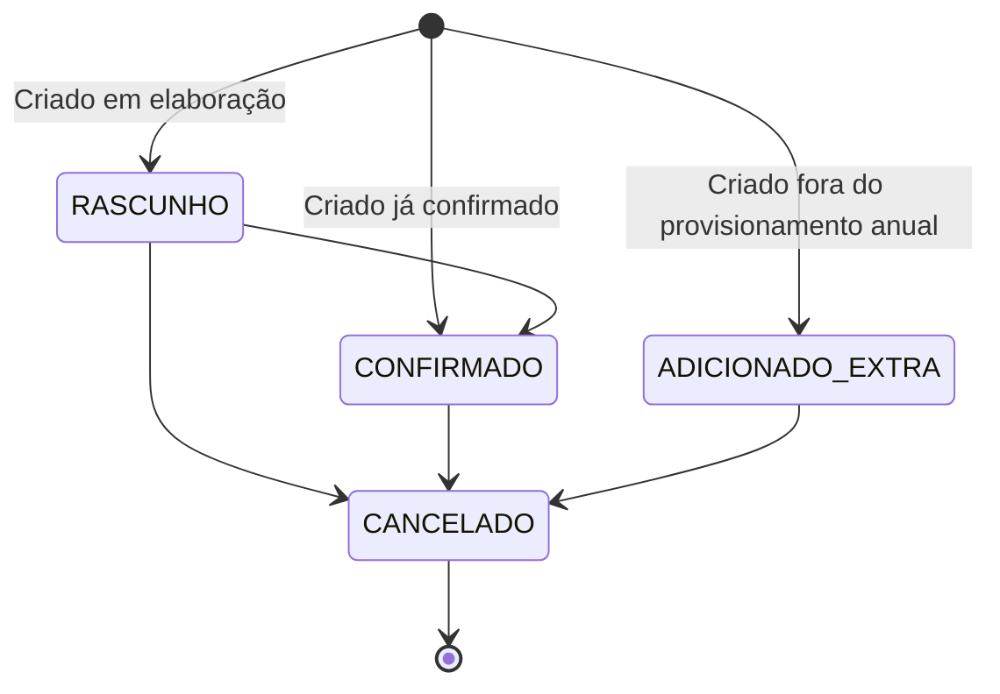

# Regras de Negócio e Fluxos: Módulo Calendário (`calendario`)

O módulo de Calendário é o coração operacional da paróquia, gerenciando eventos litúrgicos, pastorais, sociais e administrativos, com integração litúrgica universal, prevenção de choques de espaço e esteiras de aprovação.

---

## 1. Visão Geral e Propósito
Permitir o planejamento, agendamento e execução de todas as atividades celebrativas e pastorais da paróquia, garantindo estrita harmonia entre o calendário litúrgico oficial da Igreja Católica e a disponibilidade dos espaços físicos.

---

## 2. Agregados, Entidades e Value Objects Principais
- **Evento (`EventoEntity`):** entidade principal do contexto (concentra a maior parte das regras), identificada por UUID. Contém título, descrição, período (início e fim, com o tipo de horário), local, organização responsável, categoria, formato, status, justificativa, projeto de origem, regra de recorrência e envolvidos.
- **`CategoriaEvento` (Enum):** define a **prioridade** do evento na agenda: `SOLENIDADE` (nível 1); `LITURGICO` e `SACRAMENTAL` (nível 2); `PASTORAL`, `FORMATIVO`, `ADMINISTRATIVO`, `ASSISTENCIAL` e `SOCIAL` (nível 3); `MOVIMENTO` (nível 4).
- **`EventoStatusInput` (Enum):** `RASCUNHO`, `CONFIRMADO`, `ADICIONADO_EXTRA` e `CANCELADO`. A aprovação pendente **não é um status**: é indicada por campos paralelos na resposta do evento (aprovação pendente e tipo de solicitação pendente), enquanto o status oficial permanece o anterior à mudança solicitada.
- **`FormatoEvento` (Enum):** `PRESENCIAL`, `ONLINE` e `HIBRIDO`.
- **`TipoHorarioEvento` (Enum):** `PERSONALIZADO`, `DIA_INTEIRO`, `MADRUGADA`, `MANHA`, `TARDE` e `NOITE`; os blocos predefinidos já embutem a janela, dispensando margem externa.
- **`PapelEnvolvido` (Enum):** `RESPONSAVEL` e `APOIO`, o papel de cada envolvido no evento.
- **`RegraRecorrencia` (Value Object):** frequência (`DIARIA`, `SEMANAL` ou `MENSAL`), intervalo, dias da semana, posição no mês, data limite ou número de ocorrências.
- **`CorLiturgica` (Enum):** `BRANCO`, `VERMELHO`, `VERDE`, `ROXO`, `ROSA` e `PRETO`.
- **Calendário litúrgico:** ano litúrgico e ciclo, solenidades e marcos litúrgicos, calculados pelo motor litúrgico.

---

## 3. Regras de Negócio Invariantes

### RN-CAL-01: Precedência da Agenda Eclesial (`HierarquiaPrioridadeAgendaPolicy`)
- A agenda segue a precedência de quatro níveis da `CategoriaEvento`:
  - Uma **solenidade** (nível 1) cancela os eventos de nível inferior que se sobrepõem a ela; não pode haver duas solenidades no mesmo período.
  - Um evento **litúrgico ou sacramental** (nível 2) não pode se sobrepor a uma solenidade; não pode haver dois eventos litúrgicos no mesmo espaço; e cancela os eventos de nível inferior no mesmo espaço.
  - Os eventos de nível 3 e 4 não se impõem a eventos de nível superior nem ocupam o mesmo espaço de outro evento: o conflito é recusado.
- O espaço é o mesmo quando o local, ou a igreja, coincide.
- A **sobreposição** de eventos no mesmo espaço e período é sinalizada no próprio evento (estado de conflito `PENDENTE`, com o motivo), e a resolução do conflito é tratada pelo fluxo de aprovação (ver `aprovacao.md`).

### RN-CAL-02: Evento Adicionado Fora do Planejamento (`ADICIONADO_EXTRA`)
- O evento criado fora do provisionamento anual regular, com o ano litúrgico já fechado, recebe o status `ADICIONADO_EXTRA`, e a **justificativa é obrigatória**. Esse status admite apenas o cancelamento.

### RN-CAL-03: Cálculo e Sincronização do Calendário Litúrgico
- As datas móveis do ano litúrgico (Páscoa, Cinzas, Pentecostes, Corpus Christi, etc.) são calculadas com exatidão matemática via algoritmo canônico de **Meeus/Jones/Butcher**.
- **Padronização de Título de Modal/Catálogo:** A exibição do catálogo anual de solenidades segue estritamente a fórmula canônica: `Catálogo Litúrgico & Solenidades - {Ciclo} - {Ano}` (ex.: `Catálogo Litúrgico & Solenidades - Ano A - 2026`).

### RN-CAL-04: Escopo de Edição em Séries Recorrentes
- Ao editar um evento pertencente a uma série recorrente, o usuário escolhe explicitamente o escopo (`EscopoEdicaoEvento`):
  1. `SOMENTE_ESTE`: altera apenas a ocorrência selecionada.
  2. `ESTE_E_PROXIMOS`: altera a ocorrência selecionada e todas as seguintes, dividindo a série.
  3. `TODOS`: altera todas as ocorrências da série.

### RN-CAL-06: Fuso Horário de Negócio
- O fuso da paróquia é único (`America/Sao_Paulo`, configurável). Os instantes são guardados em UTC, mas todo dia civil é o de Brasília: um evento às 22h de 31/12 pertence ao ano paroquial que termina; exportação mensal e anual cobrem do primeiro ao último dia civil de Brasília (inclusive as 21h-24h do último dia); a série recorrente preserva o dia da semana e o horário local do evento-base.

### RN-CAL-07: Materialização de Recorrência
- Criada a série, só a regra afetada é materializada, no ano corrente da paróquia; no 1º de janeiro (01h, fuso da paróquia) a rotina gera o ano novo para todas as séries.
- Cada ocorrência materializada se comporta como evento criado pela tela: passa pela detecção de conflito, herda locais, ativos patrimoniais e organizações envolvidas do evento-base e cria as reservas de local e de ativo. A ocorrência que conflita com a agenda **não é materializada** (a rotina não tem aprovador) e fica registrada em log; ocorrência pendente de aprovação ou já existente também não é gerada de novo. Na rotina anual, cada ocorrência é gravada de forma independente: se uma falhar (por exemplo, o espaço foi tomado por outra requisição no meio da geração), a falha é registrada em log e as demais seguem. Ao criar a série pela tela, o conflito de qualquer ocorrência é erro e a criação inteira é desfeita.

### RN-CAL-05: Recursos e Equipamentos
- O evento que precisa de ativos patrimoniais (projetor, microfones, som) os ocupa por **reserva** (ver `reserva.md`), que respeita a disponibilidade do ativo e a manutenção em aberto.

---

## 4. Fluxos Operacionais e Casos de Uso

O ciclo de vida do status do evento é este; a aprovação pendente corre em paralelo, sem mudar o status oficial até a decisão:

1. **Submissão de Evento:** o ator com alçada cria, altera ou cancela o evento diretamente; sem alçada suficiente, ou quando a mudança é sensível, a solicitação segue para a esteira de aprovação do Pároco (`AprovadorPapel.PAROCO`).
2. **Gestão do Catálogo Litúrgico e Solenidades:** a cargo do Pároco, governo litúrgico paroquial.
3. **Visualização:** grade mensal com cores por categoria e alternância para lista corrida (agenda).
4. **Exportação** (ano, mês ou período; mês e ano em dias civis de Brasília): exportação oficial da grade e das celebrações em PowerPoint (PPTX), PDF e Word (DOCX).

---

## 5. Integrações com outros Bounded Contexts
- **`aprovacao`:** envio de requisições de criação, alteração ou cancelamento para a esteira de deliberação, quando o ator não tem alçada suficiente ou a mudança é sensível.
- **`local`:** Consulta de disponibilidade e capacidade máxima de fiéis do espaço.
- **`reserva` e `patrimonio`:** ocupação de locais e de ativos pelo evento, por reserva.
- **`organizacao`:** Associação obrigatória à pastoral, movimento ou setor responsável.
