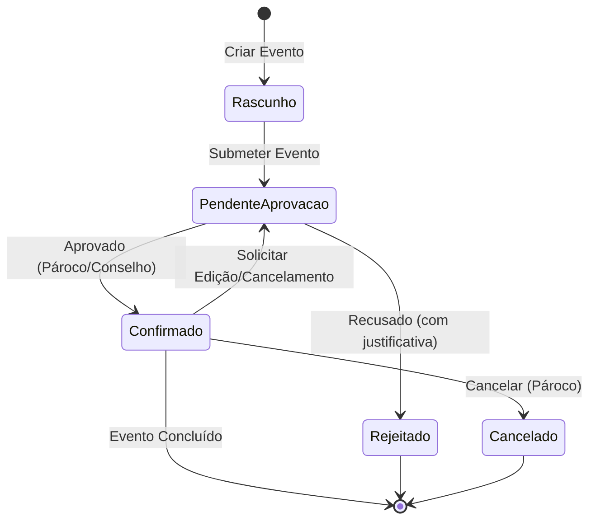

# Regras de Negócio e Fluxos: Módulo Calendário (`calendario`)

O módulo de Calendário é o coração operacional da paróquia, gerenciando eventos litúrgicos, pastorais, sociais e administrativos, com integração litúrgica universal, prevenção de choques de espaço e esteiras de aprovação.

---

## 1. Visão Geral e Propósito
Permitir o planejamento, agendamento e execução de todas as atividades celebrativas e pastorais da paróquia, garantindo estrita harmonia entre o calendário litúrgico oficial da Igreja Católica e a disponibilidade dos espaços físicos.

---

## 2. Agregados, Entidades e Value Objects Principais
- **`Evento` (Raiz de Agregado):** Entidade principal identificada por `EventoId`. Contém título, descrição, período (`DataHoraInicio`, `DataHoraFim`), local (`LocalId`), organização promotora (`OrganizacaoId`), status (`StatusEvento`), tipo litúrgico/pastoral e dados de recorrência.
- **`TipoEvento` (Enum):** `LITURGICO` (Missas, Celebrações, Sacramentos), `PASTORAL` (Encontros, Reuniões de Pastoral, Formações), `SOCIAL` (Festas, Quermesses, Almoços comunitários) e `ADMINISTRATIVO` (Reuniões de Conselho, Expediente).
- **`StatusEvento` (Enum):** `RASCUNHO`, `PENDENTE_APROVACAO`, `CONFIRMADO`, `CANCELADO`, `REJEITADO`.
- **`Recorrencia` (Value Object):** Periodicidade (`DIARIA`, `SEMANAL`, `MENSAL`), dias da semana, data de término ou contagem de ocorrências.
- **`CorLiturgica` (Enum):** `BRANCO`, `VERMELHO`, `VERDE`, `ROXO`, `ROSA`, `PRETO`.

---

## 3. Regras de Negócio Invariantes

### RN-CAL-01: Política de Choque de Horários (`ChoqueHorarioPolicy`)
- Dois eventos não podem ocupar o mesmo espaço físico (`LocalId`) no mesmo intervalo de tempo.
- Deve ser computada uma janela de preparação/desocupação configurável entre eventos sequenciais.
- **Exceção / Bypass de Pároco:** Usuários autenticados com o papel `PAROCO` possuem autorização canônica para forçar a marcação ou sobreposição em situações extraordinárias, gerando registro auditado.

### RN-CAL-02: Agendamento Extraordinário (`ADICIONADO_EXTRA`)
- Eventos cadastrados fora do planejamento anual aprovado recebem a flag ou status `ADICIONADO_EXTRA`.
- A criação de evento com essa característica exige **justificativa textual obrigatória** e é direcionada automaticamente para a esteira de aprovação.

### RN-CAL-03: Cálculo e Sincronização do Calendário Litúrgico
- As datas móveis do ano litúrgico (Páscoa, Cinzas, Pentecostes, Corpus Christi, etc.) são calculadas com exatidão matemática via algoritmo canônico de **Meeus/Jones/Butcher**.
- **Padronização de Título de Modal/Catálogo:** A exibição do catálogo anual de solenidades segue estritamente a fórmula canônica: `Catálogo Litúrgico & Solenidades - {Ciclo} - {Ano}` (ex.: `Catálogo Litúrgico & Solenidades - Ano A - 2026`).

### RN-CAL-04: Escopo de Edição em Séries Recorrentes
- Ao editar ou cancelar um evento pertencente a uma série recorrente, o usuário deve escolher explicitamente entre dois escopos:
  1. `APENAS_ESTE`: Aplica a alteração isoladamente à ocorrência selecionada, desvinculando-a da série ou criando uma exceção.
  2. `TODOS_SEGUINTES`: Propaga a alteração para a ocorrência selecionada e todas as ocorrências cronologicamente posteriores.

### RN-CAL-05: Alocação de Recursos e Equipamentos
- Caso o evento demande ativos patrimoniais (ex: sistema de som portátil, projetor, microfones sem fio), a disponibilidade do ativo no período exato deve ser validada junto ao módulo `patrimonio`.

---

## 4. Fluxos Operacionais e Casos de Uso

1. **Submissão de Evento por Líder Pastoral:** O líder submete evento -> Choque de horário é validado -> Evento entra em `PENDENTE_APROVACAO`.
2. **Visualização:** Grade mensal com cores por categoria e alternância para lista corrida (agenda).
3. **Exportação:** Exportação oficial de grade e celebrações em PowerPoint (PPTX), PDF e Word (DOCX).

---

## 5. Integrações com outros Bounded Contexts
- **`aprovacao`:** Envio de requisições de criação, alteração ou cancelamento para a esteira de deliberação.
- **`local`:** Consulta de disponibilidade e capacidade máxima de fiéis do espaço.
- **`patrimonio`:** Reserva e conferência de alocação de itens patrimoniais.
- **`organizacao`:** Associação obrigatória à pastoral, movimento ou setor responsável.
