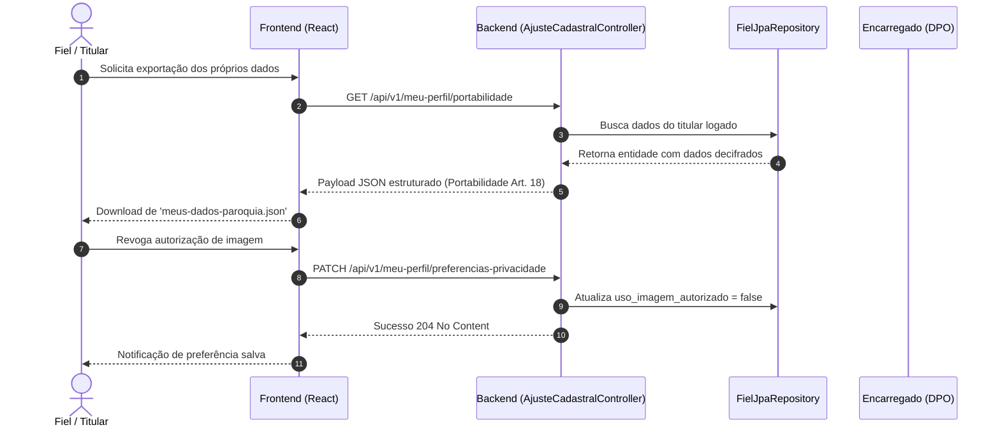

# Regras de Negócio e Governança: Privacidade e Proteção de Dados (LGPD)

O módulo transversal de Privacidade e Proteção de Dados estabelece a governança, as políticas de segurança e a garantia dos direitos dos titulares no ecossistema do **Projeto Paróquia**, em estrita conformidade com a Lei Geral de Proteção de Dados (Lei 13.709/2018), as resoluções da Autoridade Nacional de Proteção de Dados (ANPD) e as peculiaridades do Direito Canônico.

---

## 1. Visão Geral e Propósito
Assegurar a inviolabilidade da intimidade, da honra e da privacidade de fiéis leigos, clérigos, voluntários e colaboradores da paróquia. O sistema opera sob o paradigma de *Privacy by Design* e *Privacy by Default*, garantindo que todo tratamento de dados pessoais ocorra amparado em bases legais explícitas, com segurança cibernética em repouso e em trânsito, minimização e facilidade no exercício de direitos pelos titulares.

---

## 2. Agregados, Entidades e Value Objects Principais

- **`ConsentimentoLgpd` (Value Object):** Representa o consentimento formal e informado manifestado pelo titular ou seu responsável legal. Armazena:
  - `termoConsentimentoAceito` (boolean): Confirmação de leitura e adesão ao Termo Geral de Privacidade da Paróquia.
  - `dataHoraConsentimentoUtc` (Instant): Timestamp UTC imutável do momento da manifestação de vontade.
  - `ipConsentimento` (String): Endereço IP de origem do registro para fins probatórios.
  - `versaoTermoConsentimento` (String): Identificador da versão do termo vigente no ato do consentimento (ex.: `"v1.0"`).
  - `usoImagemAutorizado` (boolean): Autorização específica e destacada para captação e veiculação de imagem/vídeo em atividades pastorais.
  - `permitirDivulgacaoAniversario` (boolean): Autorização para citação de data de aniversário em murais comunitários e preces paroquiais.
- **Encarregado de Proteção de Dados (campos da configuração da paróquia, `ParoquiaConfiguracao`):** Identificação institucional do Encarregado de Proteção de Dados (DPO) nomeado pela autoridade paroquial:
  - `dpoNome` (String): Nome completo do encarregado.
  - `dpoEmail` (String): E-mail institucional oficial para contato com titulares e a ANPD.
  - `dpoTelefone` (String): Telefone institucional para atendimento a requisições de privacidade.
- **`IncidenteSeguranca` (Raiz de Agregado em `governanca`):** Registro formal de ocorrência que comprometa ou possa comprometer a confidencialidade, integridade ou disponibilidade de dados pessoais:
  - `id` (UUID): Identificador único do incidente.
  - `titulo` (String): Resumo da ocorrência.
  - `descricao` (String): Relato detalhado do evento.
  - `tipoDadoAfetado` (String): Categoria de dados expostos (dados civis, dados sensíveis/sacramentais).
  - `categoriaGravidade` (Enum: `BAIXA`, `MEDIA`, `ALTA`, `CRITICA`): Nível de severidade avaliado pelo DPO.
  - `dataOcorrencia` e `dataDeteccao` (Instant UTC): Linha do tempo do incidente.
  - `medidasMitigacao` (String): Ações imediatas e preventivas de contenção.
  - `notificadoAnpd` e `notificadoTitulares` (boolean, data e protocolo): Controle de cumprimento do prazo legal de notificação (Art. 48).
  - `status` (Enum: `EM_ANALISE`, `CONTIDO`, `NOTIFICADO`, `ENCERRADO`).

---

## 3. Regras de Negócio Invariantes

### RN-LGP-01: Criptografia em Repouso e Blind Indexing (Art. 46)
- Todos os atributos com dados pessoais civis identificadores (nome civil, CPF, RG, telefones, e-mail, data de nascimento e endereço completo de fiéis e clérigos), bem como o nome, e-mail e CPF do solicitante de uma requisição ao DPO e o IP e os dados do responsável legal da trilha de consentimento, são obrigatoriamente cifrados no banco de dados via AES-256/GCM (cifra autenticada, IV de 12 bytes aleatório por valor).
- O valor cifrado é gravado com prefixo de versão de chave (`v1:`), permitindo rotação futura. Registros no formato legado AES-CBC (sem prefixo) continuam legíveis e são regravados em GCM na subida da aplicação por rotina idempotente; uma falha de decifragem (chave divergente, dado adulterado) é erro explícito e nunca devolve o ciphertext como se fosse o valor.
- Para permitir validação de unicidade cadastral e consultas exatas sem decifrar a base em lote, o CPF gera um blind index `cpf_hash` por HMAC-SHA256 com chave própria (*pepper*, propriedade `app.security.cpf-pepper`, obrigatória e sem valor padrão), distinta da chave de cifragem. Fiéis e clérigos possuem o mesmo índice; a busca pública por CPF jamais decifra a base de clérigos.
- Migração dos dados existentes (expand & contract): a V040 alarga as colunas, a V041 (Java, idempotente) cifra os dados do DPO/trilha que estavam em claro e recalcula o `cpf_hash` de fiéis (SHA-256 puro para HMAC) e clérigos, e a V042 torna a trilha de consentimento *append-only*.

### RN-LGP-02: Minimização e Segregação de DTOs (Art. 6º, III)
- Endpoints de listagem pública ou com escopo de liderança pastoral não expõem documentos civis, filiação ou endereço completo.
- Coordenadores de pastoral têm acesso restrito ao contrato `FielContatoResponse`, contendo apenas nome e contatos autorizados de membros do seu grupo.
- O contrato institucional de clérigos (`ClerigoInstitucionalResponse`) expõe unicamente nome de ordenação, grau da ordem, ofício atual e paróquia, resguardando os dados civis.

### RN-LGP-03: Paridade Irrevogável Clérigo / Fiel
- Clérigos (bispos, padres, diáconos) gozam exatamente do mesmo regime jurídico de proteção de privacidade que os fiéis leigos. É expressamente vedado utilizar dados civis de ministros sagrados como identificadores públicos.

### RN-LGP-04: Portabilidade de Dados em Formato Interoperável (Art. 18, V)
- Todo titular cadastrado como fiel e autenticado no sistema tem o direito de requisitar e baixar a qualquer momento um arquivo estruturado (`meus-dados-paroquia.json`) contendo a integralidade dos seus dados civis decifrados, seus relacionamentos familiares, seu histórico pastoral e seus vínculos sacramentais.

### RN-LGP-05: Direito à Revogação de Consentimentos Secundários (Art. 8º, § 5º)
- O fiel pode alterar e revogar a qualquer momento as autorizações para uso de imagem e divulgação de aniversário diretamente em seu perfil (`PATCH /api/v1/meu-perfil/preferencias-privacidade`) ou pelo Portal de Consentimento (`/portal/consentimento`), com efeito imediato nas rotinas de exportação e murais.

### RN-LGP-06: Fé Pública Canônica e Exceção de Guarda (Art. 16, I)
- Os assentos dos Livros Paroquiais (Batismo, Crisma, Matrimônio e Ordem) são dotados de fé pública eclesiástica perpétua e constituem patrimônio histórico e canônico da Igreja Católica.
- A exclusão ou expurgo de cadastro civil de fiel anonimiza seus dados cadastrais pastorais, mas **não acarreta a exclusão física do livro de assento sacramental**. Eventuais correções de dados sacramentais ocorrem exclusivamente através de Averbações Formais lavradas no livro.
- **Anonimização completa e em paridade (fiel e clérigo):** cinco anos após a inativação, o cadastro é anonimizado: zera nome/nome civil, CPF e seu blind index, RG, documentos, contatos, endereço, data de nascimento, sexo (fiel), carimbo e IP de consentimento e autorizações; elimina os dependentes e desativa os vínculos familiares; anonimiza IP, user-agent e dados do responsável legal na trilha de consentimento (o evento permanece como prova); e desativa a conta de usuário, trocando o nome de usuário por marcador opaco e inutilizando a senha. Para o clérigo permanecem apenas os dados institucionais e canônicos (nome eclesiástico, grau da ordem, ordenações e encargos).

### RN-LGP-07: Publicidade dos Canais do Encarregado de Dados / DPO (Art. 41)
- A identidade e os canais de contato oficiais (e-mail institucional e telefone) do Encarregado de Proteção de Dados (DPO) são públicos e acessíveis a todos os titulares de dados, sem exigência de autenticação prévia, visíveis no rodapé e na página institucional do sistema.

### RN-LGP-08: Notificação Tempestiva de Incidentes de Segurança (Art. 48)
- Qualquer evento de segurança que comprometa dados pessoais deve ser registrado formalmente pelo DPO ou pela administração paroquial. Incidentes que acarretem risco relevante aos titulares devem ser comunicados à ANPD e aos titulares afetados no prazo de até 3 (três) dias úteis, contados da detecção (sábados, domingos e feriados nacionais não contam, incluindo a Sexta-feira da Paixão; feriados estaduais e municipais não são considerados). O registro expõe o prazo e sinaliza vencimento enquanto a ANPD não foi notificada e o incidente não foi encerrado.
- A data de detecção não pode anteceder a de ocorrência. O status só avança (`EM_ANALISE` → `CONTIDO` → `NOTIFICADO` → `ENCERRADO`, podendo pular etapas inaplicáveis), `NOTIFICADO` exige a notificação à ANPD registrada e `ENCERRADO` é final.

### RN-LGP-09: PII Zero em Logs
- É terminantemente proibido imprimir nomes civis, CPFs, e-mails, telefones ou objetos completos de entidades em logs de aplicação (`INFO`, `DEBUG`, `WARN`, `ERROR`). Toda telemetria utiliza identificadores opacos (`UUID`).

### RN-LGP-10: Autoatendimento Passwordless de Consentimento e Revogação (Art. 8º, § 5º e Art. 9º)
- O sistema disponibiliza o Canal Portal de Autoatendimento (`/portal/consentimento`), permitindo que titulares (fiéis ou clérigos cadastrados pela secretaria) concedam ou revoguem seus consentimentos sem a necessidade de criação de usuário/senha ou login formal.
- A validação de identidade ocorre através de desafio OTP (*One-Time Password*) de 6 dígitos numéricos gerado de forma criptograficamente segura (`SecureRandom`) e enviado exclusivamente ao endereço de e-mail previamente cadastrado na secretaria.
- Medidas de segurança antiabuso:
  - Rate limiting estrito: máximo de 3 pedidos de código a cada 15 minutos por titular; pedidos excedentes são descartados sem envio; a contagem é atômica (lock por titular no banco), mesmo sob pedidos simultâneos;
  - Bloqueio por tentativas inválidas: máximo de 3 tentativas por código (o contador é persistido a cada erro); esgotadas, até o código correto é recusado e é preciso pedir novo código;
  - Anti-enumeração: a resposta ao pedido de código é idêntica para CPF inexistente, titular sem e-mail cadastrado, limite excedido e envio efetuado (inclusive a mensagem exibida na tela, que não mostra o e-mail mascarado), e todos os erros de validação usam a mesma mensagem; o e-mail é enviado de forma assíncrona após o commit;
  - Armazenamento em repouso do código apenas sob hash irreversível SHA-256 (`codigo_hash`);
  - Tempo de expiração de 10 minutos para o código e token temporário efêmero HMAC-SHA256 válido por 15 minutos após validação, **de uso único**: o token carrega o identificador do desafio validado, consumido atomicamente na primeira manifestação ou revogação.
- O envio do código e do comprovante usa a porta `EnviadorEmailConsentimento`: com `app.mail.enabled=true` o adaptador SMTP (`spring.mail.*` e `app.mail.remetente`) envia de fato; por padrão (desenvolvimento/testes) o adaptador não envia. Nem o código nem o endereço de e-mail são registrados em log.
- Nas manifestações, `termoAceito=false` (revogação) força `usoImagemAutorizado` e `permitirDivulgacaoAniversario` a `false`; o CPF do responsável legal é validado (dígitos verificadores). O IP de origem é o endereço da conexão: `X-Forwarded-For` só é considerado quando o contêiner é configurado atrás de proxy confiável (`server.forward-headers-strategy=native`).
- Toda manifestação gera registro na trilha forense imutável (*append-only* no banco: DELETE e UPDATE bloqueados por gatilho, salvo a anonimização de PII) `calendario.historico_consentimentos` com IP, User-Agent, canal (`PORTAL`), método de autenticação (`OTP_EMAIL`), versão e hash SHA-256 do termo legal.

### RN-LGP-11: Salvaguarda Legal e Canônica de Menores (Art. 14, § 1º)
- Para titulares menores de 18 anos, o tratamento de dados pessoais requer consentimento específico e em destaque fornecido por pelo menos um dos pais ou responsável legal.
- No cadastro via secretaria e na manifestação via portal, são exigidos obrigatoriamente o nome completo (`responsavel_menor_nome`) e o CPF (`responsavel_menor_cpf`) do genitor ou tutor legal.

### RN-LGP-12: Transparência Ativa e Diálogo Canônico de Revogação (Art. 16, I e Cân. 535)
- No momento da revogação pelo portal, o titular é orientado sobre a distinção jurídica fundamental: a revogação cessa imediatamente os tratamentos secundários (imagem, voz, murais de aniversário e comunicações comunitárias), mas **não extingue os assentos dos livros sacramentais** (Batismo, Crisma, Matrimônio e Ordem), que permanecem preservados em custódia perpétua por obrigação canônica e dever histórico (Art. 16, I da LGPD e Cân. 535 do Código de Direito Canônico).
- Ao final, é emitido Comprovante Digital de Manifestação auditável contendo protocolo único, data/hora UTC e hash do termo manifestado.

### RN-LGP-13: Registro de Operações de Tratamento - ROPA (Art. 37)
- O Encarregado (DPO) e a administração mantêm no painel de governança o inventário formal de Operações de Tratamento de Dados Pessoais (ROPA), mapeando finalidades, categorias de titulares, bases legais (Arts. 7º, 11 e 14), dados sensíveis envolvidos, compartilhamentos e prazos de retenção.
- O inventário é disponibilizado para visualização tabular, impressão oficial e exportação eletrônica em JSON interoperável.

### RN-LGP-14: Canal de Atendimento a Requisições de Titulares / DSAR (Arts. 18 e 19)
- Disponibilização de canal público para encaminhamento de requisições e dúvidas diretamente ao DPO (`POST /api/v1/publico/dpo/solicitar`), com geração de protocolo público auditável (`DPO-AAAAMMDD-` seguido de 12 caracteres aleatórios; o sufixo longo evita enumeração, pois a consulta por protocolo é pública).
- A consulta pública por protocolo (`GET /api/v1/publico/dpo/solicitacao/{protocolo}`) e o eco da abertura devolvem nome, e-mail e CPF mascarados; o painel do DPO vê os dados completos.
- O DPO dispõe de painel para moderação e resposta formal no prazo legal improrrogável de 15 (quinze) dias estabelecido pelo Art. 19, II da LGPD; a solicitação expõe `prazoRespostaUtc`, `prazoVencido` e `diasRestantesPrazo`.
- Status: `RECEBIDA` → `EM_ANALISE` → (`ATENDIDA` ou `REJEITADA`). A resposta pode levar direto a um estado final; `RECEBIDA` nunca é destino e solicitação concluída não é reaberta nem respondida de novo (novo pedido, novo protocolo). A data de resposta só é gravada na conclusão.

### RN-LGP-15: Transparência Pública da Política de Privacidade (Art. 9º)
- A Política de Privacidade e Proteção de Dados é pública em `/politica-privacidade`, contendo identificação e contatos do Controlador e do DPO, rol de finalidades, hipóteses de uso compartilhado estritamente eclesial (Mitra Diocesana e Tribunais Eclesiásticos) e vedação absoluta e expressa de comercialização de dados para fins mercadológicos (Art. 11, § 4º).

---

## 4. Fluxos Operacionais e Casos de Uso

1. **Manifestação e Registro de Consentimento:**
   - No ato do cadastro de fiel (`POST /api/v1/fieis`), a secretaria registra a concordância do titular com o Termo de Privacidade, colhendo autorizações granulares para imagem e aniversários.
2. **Exercício do Direito à Portabilidade:**
   - O fiel acessa seu perfil e aciona a exportação estruturada. O sistema decifra seus dados pessoais, compila seus vínculos sacramentais e gera payload JSON sem interferência humana.
3. **Revogação de Autorização:**
   - O fiel desmarca opções de divulgação de aniversário ou imagem. O sistema atualiza os atributos e cessa imediatamente a elegibilidade do fiel para murais e fotos.
4. **Ciclo de Retenção e Anonimização:**
   - Cadastros inativos há mais de 5 anos são identificados pelo agendador diário (`AgendadorAnonimizacaoCadastroFielJob`), que executa `fiel.anonimizar()`, limpando documentos e marcando `dados_cadastrais_eliminados = true`.
5. **Gestão e Resposta a Incidentes:**
   - Em caso de suspeita de violação, o Pároco ou Administrador registra o incidente em Governança. O DPO avalia o risco, adota medidas de contenção e despacha os comunicados necessários para a ANPD e os titulares.

---

## 5. Integrações com outros Bounded Contexts

- **`fiel`:** Aplicação da cifragem de PII civil, blind index de CPF e persistência de consentimento.
- **`clero`:** Aplicação do princípio da paridade para ministros sagrados e seus dependentes.
- **`sacramento`:** Harmonização entre preservação histórica perpétua e direitos de privacidade (fé pública canônica).
- **`iam`:** Desativação imediata de credenciais de acesso de titulares anonimizados e controle de papéis (RBAC).
- **`governanca`:** Manutenção da identidade do DPO na paróquia e registro formal de incidentes de segurança.

---

## 6. Privacidade & Segurança (LGPD e RBAC)

- **Permissões de Configuração do DPO:** Exclusivas para `ROLE_PAROCO` e `ROLE_ADMIN`.
- **Permissões de Registro de Incidentes:** Exclusivas para `ROLE_PAROCO` e `ROLE_ADMIN`.
- **Permissões de Consulta a Dados Civis Completos:** `ROLE_PAROCO`, `ROLE_ADMIN`, `ROLE_SECRETARIA_PAROQUIAL`.
- **Permissões de Consulta de Contato Pastoral:** `ROLE_COORDENADOR` (restrito aos fiéis do seu próprio grupo via anti-IDOR).
- **Permissões de Portabilidade e Revogação:** Todo usuário autenticado acessa exclusivamente os seus próprios dados.
