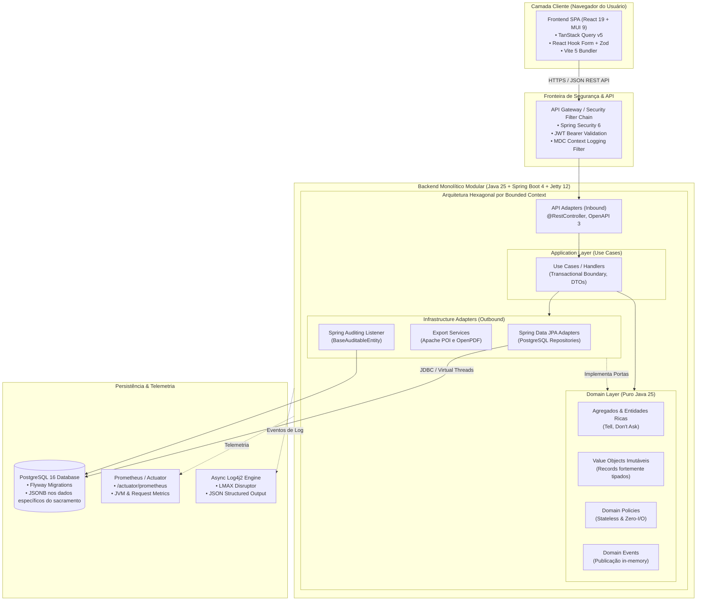

# 🏛️ Padrões de Arquitetura

Este documento detalha as decisões arquiteturais estruturantes do **Projeto Paróquia**, abordando o estilo arquitetural adotado tanto no backend quanto no frontend, com diagramas conceituais em Mermaid.

---

## 1. Visão Sistêmica e Diagrama de Arquitetura

O sistema é construído sobre o padrão **C4 Model (Nível 2 - Container)**, implementado como um **Monólito Modular** no backend e uma **SPA Reativa** no frontend, garantindo simplicidade operacional com isolamento rigoroso de código.



---

## 2. Princípios Fundamentais de Arquitetura

### 2.1. Arquitetura Hexagonal (Ports & Adapters) & Clean Architecture

O backend organiza cada um dos 17 domínios (+ módulo transversal `support`) em 4 camadas bem delimitadas:

```
br.com.nsfatima.gestao.<contexto>/
├── domain/                  <-- O coração do sistema: 100% puro Java, zero anotações de framework
│   ├── model/               <-- Agregados, Entidades e Value Objects
│   ├── policy/              <-- Regras de negócio variáveis (Estratégias puras)
│   ├── event/               <-- Eventos de domínio imutáveis
│   └── repository/          <-- Portas de saída (interfaces puras do domínio)
├── application/             <-- Orquestração da lógica da aplicação
│   ├── usecase/             <-- Casos de uso atômicos (@Transactional)
│   ├── dto/                 <-- DTOs de entrada e saída
│   └── mapper/              <-- Conversores de dados entre Domínio e DTOs
├── api/                     <-- Porta de entrada HTTP
│   ├── v1/controller/       <-- Controllers REST com OpenAPI e @PreAuthorize
│   └── v1/dto/              <-- Contratos de requisição e resposta do cliente
└── infrastructure/          <-- Adaptadores de saída e integração externa
    ├── persistence/         <-- Entidades JPA, Repositórios Spring Data e Mappers de BD
    └── config/              <-- Configurações específicas do Spring Framework
```

#### Regras Mandatórias de Isolamento:
1. **Domínio Agnóstico:** A pasta `domain/` é estritamente proibida de importar pacotes do Spring Framework, Hibernate, Jakarta Persistence ou qualquer biblioteca externa de persistência/rede.
2. **Injeção de Dependências por Interfaces:** O caso de uso (`application`) interage apenas com a interface do repositório (`domain/repository/`). O adaptador JPA (`infrastructure/persistence/`) implementa essa interface.

---

### 2.2. O Modelo de Execução com Virtual Threads (Java 25)

A aplicação tira proveito pleno das **Virtual Threads (Project Loom)** do Java 25 executando no servidor embarcado **Jetty 12**:

- **Alta Vazão sem Complexidade Reativa:** Código síncrono e legível com o mesmo throughput de pipelines reativos (WebFlux/Reactor).
- **Diretriz Anti-Pinning:** É estritamente proibido o uso de blocos `synchronized` em operações que realizem chamadas de rede ou consultas ao banco de dados, utilizando em seu lugar primitivas não-bloqueantes ou `ReentrantLock` para evitar fixação (*pinning*) na carrier thread do sistema operacional.

---

### 2.3. Auditoria Centralizada e Imutável (`BaseAuditableEntity`)

Todas as entidades mapeadas no banco de dados compartilham o mesmo contrato unificado de auditoria:

- **Herança Canônica:** Todas as entidades JPA estendem `BaseAuditableEntity`.
- **4 Colunas Padronizadas:**
  - `criado_em_utc`: Timestamp UTC no momento da persistência inicial.
  - `atualizado_em_utc`: Timestamp UTC atualizado automaticamente em mutações.
  - `criado_por`: Identificador/username do operador autenticado.
  - `atualizado_por`: Identificador/username da última alteração.
- **Auditoria 100% Automática:** Executada exclusivamente pelo `AuditingEntityListener` do Spring Data JPA com `DateTimeProvider` fixado em UTC. Proíbe-se qualquer manipulação manual desses campos em use cases.

---

### 2.4. Arquitetura do Frontend Reativo (React 19)

O frontend adota DDD e Arquitetura Hexagonal nos seus 16 bounded contexts (`src/contextos/<contexto>/`). Cada contexto replica a fronteira `domain`, `application`, `infrastructure` e `presentation`; `app` compõe a SPA e `shared` contém apenas capacidades transversais.

1. **Separação Estado de Servidor vs Estado de Interface:**
   - **Server State:** Gerenciado exclusivamente pelo **TanStack React Query v5**, provendo cache inteligente, invalidação após mutações e suporte a *optimistic updates*.
   - **Form State:** Controlado pelo **React Hook Form** validado por esquemas declarativos **Zod**.
2. **Fronteiras Hexagonais:**
   - `domain` é TypeScript puro e não depende de React, Axios, MUI ou TanStack Query.
   - `application` declara portas e casos de uso; `infrastructure/http` fornece adapters HTTP.
   - `presentation` contém páginas, componentes, hooks de Query e schemas Zod, sem acessar Axios diretamente.
3. **Componentes Finos (*Thin Components*):**
   - O JSX é restrito a apresentação e ligações semânticas (10 a 60 linhas de código).
   - Cálculos, transformações e lógica de API são encapsulados em hooks especializados do contexto (ex.: `useCalendarioGrid`, `useEventoCrud`).
4. **Design System & Acessibilidade:**
   - Construído com base em primitivas de layout do **Material UI 9** (`Box`, `Stack`, `Grid`, `Typography`, `Card`), proibindo tags HTML cruas para manter consistência responsiva.

---

### 2.5. Validação Arquitetural Contínua com ArchUnit

Para blindar a arquitetura contra degradação estrutural e violações de fronteiras, o projeto integra o **ArchUnit 1.4.0** à esteira de testes automatizados do Gradle (`br.com.nsfatima.gestao.architecture.*`), garantindo que 100% das invariantes sejam checadas a cada build:

| Classe de Teste | Invariantes Validadas |
| :--- | :--- |
| `HexagonalArchitectureTest` | • Domínio 100% puro Java 25 (zero frameworks Spring/JPA/Jackson).<br>• Domínio não depende de camadas externas (`application`, `api`, `infrastructure`).<br>• `application` não depende de persistência concreta nem de `api`.<br>• `api` não consome repositórios Spring Data JPA diretamente. |
| `DomainPolicyArchitectureTest` | • Todas as classes `*Policy` residem em `domain.policy`.<br>• Policies são estritamente stateless e zero-I/O (sem anotações `@Service`, `@Component`, etc.).<br>• Policies não dependem de classes do pacote `infrastructure`. |
| `JpaEntityArchitectureTest` | • Todas as entidades `@Entity` residem em `infrastructure.persistence.entity`.<br>• Todas as entidades JPA estendem obrigatoriamente `BaseAuditableEntity`.<br>• Nenhuma anotação de persistência relacional vaza para a camada `domain`. |
| `RestControllerArchitectureTest` | • Todos os controllers `@RestController` residem em pacotes `api`.<br>• Zero métodos `@ExceptionHandler` inline em controllers (centralizados em `@RestControllerAdvice`).<br>• Controllers não dependem diretamente de entidades JPA de persistência. |
| `ModularMonolithArchitectureTest` | • Domínio de um bounded context não acessa a persistência de outro contexto.<br>• Camada de aplicação não acessa diretamente entidades JPA privadas de outros contextos. |

---

### 2.6. Infraestrutura de Testes com Testcontainers (PostgreSQL 16) & Docker Wormhole

Para garantir paridade total entre os ambientes de teste, desenvolvimento e produção, o projeto elimina bancos em memória sintéticos (como H2) em favor de instâncias reais do **PostgreSQL 16** via **Testcontainers**:

1. **Paridade de Dialeto e Migrações Flyway:**
   - Todos os testes de integração, repositório (`@DataJpaTest`) e esteiras Spring executam sobre um container PostgreSQL 16 (`jdbc:tc:postgresql:16-alpine:///calendario?TC_DAEMON=true`).
   - Recursos específicos do PostgreSQL (blocos anônimos `DO $$`, `ON CONFLICT`, funções de data, índices parciais e schemas) são validados exatamente como em produção.
2. **Dimensionamento do Connection Pool nos Testes:**
   - O HikariCP de teste é calibrado com `maximum-pool-size: 3` e expiração agressiva de conexões ociosas para evitar a exaustão de conexões no PostgreSQL compartilhado entre múltiplos contextos de teste.
3. **Padrão Docker Wormhole (Docker-in-Docker Sibling Pattern):**
   - Para builds e testes executados dentro de containers Docker (CI/CD ou serviço `builder` do `docker-compose.yml`), adota-se o padrão canônico **Docker Wormhole**:
     - Compartilhamento do socket do Docker host (`/var/run/docker.sock:/var/run/docker.sock`).
     - Montagem do workspace do host no **mesmo caminho absoluto** no container (`${PWD}:${PWD}`) com `working_dir: ${PWD}/gestao-paroquia`.
     - Variável de ambiente `TESTCONTAINERS_HOST_OVERRIDE=host.docker.internal` e cliente `docker-cli` instalado na imagem construtora (`Dockerfile.builder`).
     - Dessa forma, os containers de teste criados pelo Testcontainers são orquestrados como contêineres irmãos (*sibling containers*) no daemon do host com resolução correta de bind mounts.

