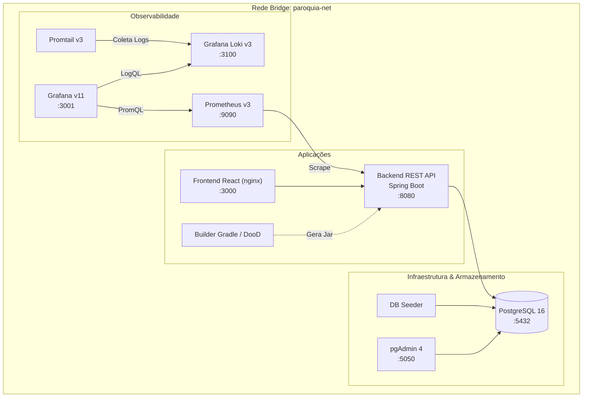

# 🐳 Infraestrutura Docker e Orquestração

O projeto **Paróquia** conta com uma arquitetura de contêineres moderna, isolada e com governança de recursos configurada via Docker Compose.

---

## 🏛️ Topologia dos Serviços

A rede virtual `paroquia-net` (driver `bridge`) interliga os componentes do sistema:



---

## 📋 Mapeamento de Portas e Serviços

| Serviço | Contêiner | Imagem Base | Porta Host | Finalidade | Credenciais |
| :--- | :--- | :--- | :--- | :--- | :--- |
| **Frontend UI** | `gestao-ui` | `nginxinc/nginx-unprivileged:1.27-alpine` | `3000` | Interface Web React (build estático + nginx) | - |
| **Backend API** | `gestao-api` | `eclipse-temurin:25-jre-alpine` | `8080` | REST API Spring Boot | - |
| **Banco de Dados** | `gestao-db` | `postgres:16-alpine` | `5432` | PostgreSQL 16 | `postgres` / `POSTGRES_PASSWORD` do `.env` |
| **DB Seeder** | `gestao-db-seeder` | `postgres:16-alpine` | N/A | Carga de dados de teste (somente `--profile dev`) | `postgres` / `POSTGRES_PASSWORD` do `.env` |
| **Builder** | `gestao-builder` | `eclipse-temurin:25-jdk-alpine` | N/A | Compilação e Testcontainers | Usuário: `dev` |
| **pgAdmin 4** | `gestao-pgadmin` | `dpage/pgadmin4:9.1` | `5050` | Interface do Banco | `PGADMIN_DEFAULT_EMAIL` / `PGADMIN_DEFAULT_PASSWORD` do `.env` |
| **Prometheus** | `gestao-prometheus` | `prom/prometheus:v3.2.1` | `9090` | Armazenamento de Séries Temporais | - |
| **Grafana** | `gestao-grafana` | `grafana/grafana:11.5.2` | `3001` | Dashboards em Tempo Real | `GRAFANA_ADMIN_USER` / `GRAFANA_ADMIN_PASSWORD` do `.env` |
| **Loki** | `gestao-loki` | `grafana/loki:3.2.1` | `3100` | Agregação de Logs Estruturados | - |
| **Promtail** | `gestao-promtail` | `grafana/promtail:3.2.1` | N/A | Coletor de Logs para Loki | - |

---

## 🔒 Boas Práticas Implementadas

1. **Princípio do Menor Privilégio (Non-root Containers):**
   - API executa sob usuário `appuser`.
   - Frontend executa nginx sem privilégios (`nginx-unprivileged`).
   - Builder utiliza `gosu dev` com mapeamento dinâmico de permissões do socket Docker (`/var/run/docker.sock`).
2. **Rotação Automática de Logs:**
   - Todos os serviços possuem `json-file` configurado para no máximo 3 arquivos de 10MB (`max-size: 10m`, `max-file: 3`), evitando preenchimento descontrolado de disco.
3. **Limites Rígidos de Recursos (Resource Quotas):**
   - Todos os contêineres definem limites de memória (`mem_limit`) e CPU (`cpus`), com o processo de build estritamente limitado a no máximo 30% da capacidade do host (3 CPUs e 4GB RAM).
4. **Isolamento de Rede:**
   - Rede bridge dedicada `paroquia-net` para tráfego inter-contêineres com resolução de nomes DNS interna.

---

## 🚀 Scripts Canônicos de Execução

### `docker-env.sh` (Gerenciador do Ciclo Docker)
```bash
# Iniciar todos os serviços
./docker-env.sh up

# Reiniciar com limpeza de volumes
./docker-env.sh restart --clean

# Inspecionar status e consumo de recursos
./docker-env.sh status

# Acompanhar logs de um serviço
./docker-env.sh logs -f -s api
```

### `manage.sh` (CLI Unificada do Projeto)
```bash
# Iniciar infraestrutura e rodar backend/frontend localmente com hot-reload
./manage.sh dev

# Rodar todos os quality gates (Checkstyle, PMD, SpotBugs, ArchUnit)
./manage.sh check

# Executar suíte de testes automatizados
./manage.sh test

# Encerrar processos locais e contêineres
./manage.sh stop
```

---

## Segredos, credenciais e perfil dev

- **Sem credenciais padrão:** o `docker-compose.yml` não contém senhas. Copie `.env.example` para `.env` (ignorado pelo controle de versão), substitua todos os valores `<...>` (`openssl rand -hex 32`) e só então suba o ambiente. Variáveis obrigatórias ausentes abortam o `docker compose` (`${VAR:?}`); `docker-env.sh` também recusa executar sem `.env`.
- **Segredos da API:** `APP_CRYPTO_KEY` e `APP_CONSENT_SECRET` (mínimo 32 caracteres) são obrigatórios; a API não sobe sem eles. Trocar `APP_CRYPTO_KEY` depois de gravar dados torna ilegíveis os campos já cifrados. `APP_METRICS_SCRAPE_TOKEN` é o token Bearer com o qual o Prometheus raspa `/actuator/prometheus` (entregue ao Prometheus como secret do compose); as demais métricas, o Swagger e a OpenAPI exigem login ADMIN.
- **Cookie de sessão:** `SESSION_COOKIE_SECURE=false` apenas para HTTP local; atrás de TLS use `true`.
- **Perfil `dev`:** o `docker compose --profile dev` habilita o `db-seeder` (usuários de teste com senha em texto claro `{noop}senha123`, também via `./docker-env.sh seed`) e o `ui-dev` (Vite com hot reload em `:5173`). Nunca use o seeder em ambiente real. Rodando a API localmente (`./manage.sh dev`), o script ativa `SPRING_PROFILES_ACTIVE=dev`, que carrega `application-dev.yml` (chaves de desenvolvimento públicas, Swagger habilitado, cookie sem `Secure`, `baseline-on-migrate`). Esse perfil jamais deve ser ativado em produção.
- **Portas:** infraestrutura (db, pgAdmin, Prometheus, Grafana, Loki, exporter) publica apenas em `127.0.0.1`.
- **Promtail** permanece como root: ler o socket do Docker equivale a root no host e o GID do grupo `docker` varia por máquina. **Loki** mantém logs por 7 dias (`retention_period: 168h` com compactor).
- **UI de produção:** `Dockerfile.ui` (alvo `runtime`) compila o SPA e o serve com `nginx-unprivileged` (porta interna 8080, publicada em `:3000`), com fallback de SPA e proxy de `/api` para a API na mesma origem, além de CSP e demais cabeçalhos de segurança (`docker/nginx/default.conf`). O alvo `dev` (`npm run dev`) existe somente para desenvolvimento.
- **IP do rate limit atrás de proxy:** por padrão só o IP da conexão (`getRemoteAddr()`) é usado; `X-Forwarded-For` é ignorado por ser forjável. Atrás de proxy reverso, defina `APP_TRUSTED_PROXIES` (IPs dos proxies, separados por vírgula): o cabeçalho só é lido quando a conexão vem de um deles. Na rede do compose o proxy da UI (nginx) tem IP dinâmico; sem configurar, o limite passa a ser por usuário para todos os acessos via UI.
