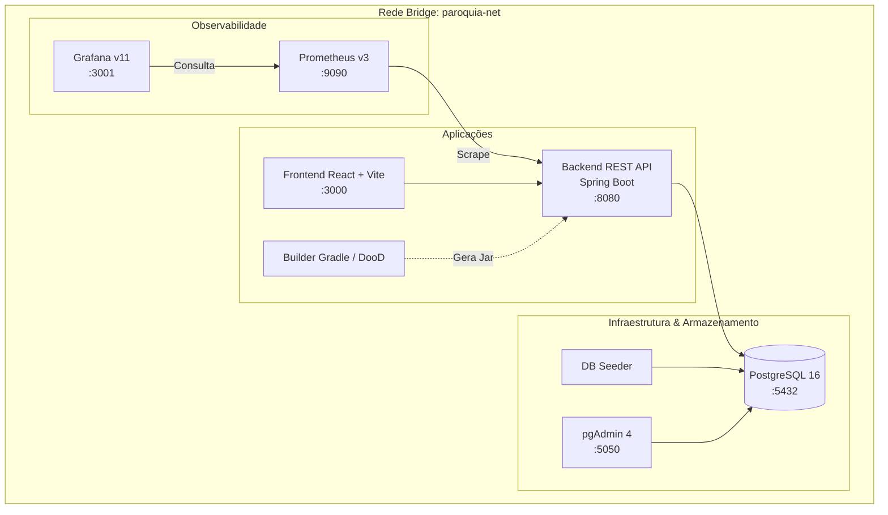

# 🐳 Infraestrutura Docker e Orquestração

O projeto **Paróquia** conta com uma arquitetura de contêineres moderna, isolada e com governança de recursos configurada via Docker Compose.

---

## 🏛️ Topologia dos Serviços

A rede virtual `paroquia-net` (driver `bridge`) interliga os componentes do sistema:



---

## 📋 Mapeamento de Portas e Serviços

| Serviço | Contêiner | Imagem Base | Porta Host | Finalidade | Credenciais |
| :--- | :--- | :--- | :--- | :--- | :--- |
| **Frontend UI** | `gestao-ui` | `node:22-alpine` | `3000` | Interface Web React | - |
| **Backend API** | `gestao-api` | `eclipse-temurin:25-jre-alpine` | `8080` | REST API Spring Boot | - |
| **Banco de Dados** | `gestao-db` | `postgres:16-alpine` | `5432` | PostgreSQL 16 | `postgres` / `password` |
| **Builder** | `gestao-builder` | `eclipse-temurin:25-jdk-alpine` | N/A | Compilação e Testcontainers | Usuário: `dev` |
| **pgAdmin 4** | `gestao-pgadmin` | `dpage/pgadmin4:9.1` | `5050` | Interface do Banco | `admin@paroquia.local` / `admin` |
| **Prometheus** | `gestao-prometheus` | `prom/prometheus:v3.2.1` | `9090` | Armazenamento de Séries Temporais | - |
| **Grafana** | `gestao-grafana` | `grafana/grafana:11.5.2` | `3001` | Dashboards em Tempo Real | `admin` / `admin` |

---

## 🔒 Boas Práticas Implementadas

1. **Princípio do Menor Privilégio (Non-root Containers):**
   - API executa sob usuário `appuser`.
   - Frontend executa sob usuário `node`.
   - Builder utiliza `gosu dev` com mapeamento dinâmico de permissões do socket Docker (`/var/run/docker.sock`).
2. **Rotação Automática de Logs:**
   - Todos os serviços possuem `json-file` configurado para no máximo 3 arquivos de 10MB (`max-size: 10m`, `max-file: 3`), evitando preenchimento descontrolado de disco.
3. **Limites Rígidos de Recursos (Resource Quotas):**
   - Todos os contêineres definem limites de memória (`mem_limit`) e CPU (`cpus`), com o processo de build estritamente limitado a no máximo 30% da capacidade do host (3 CPUs e 4GB RAM).
4. **Isolamento de Rede:**
   - Rede bridge dedicada `paroquia-net` para tráfego inter-contêineres com resolução de nomes DNS interna.

---

## 🚀 Scripts Canônicos de Execução

### `docker-env.sh` (Gerenciador do Ciclo Docker)
```bash
# Iniciar todos os serviços
./docker-env.sh up

# Reiniciar com limpeza de volumes
./docker-env.sh restart --clean

# Inspecionar status e consumo de recursos
./docker-env.sh status

# Acompanhar logs de um serviço
./docker-env.sh logs -f -s api
```

### `manage.sh` (CLI Unificada do Projeto)
```bash
# Iniciar infraestrutura e rodar backend/frontend localmente com hot-reload
./manage.sh dev

# Rodar todos os quality gates (Checkstyle, PMD, SpotBugs, ArchUnit)
./manage.sh check

# Executar suíte de testes automatizados
./manage.sh test

# Encerrar processos locais e contêineres
./manage.sh stop
```
