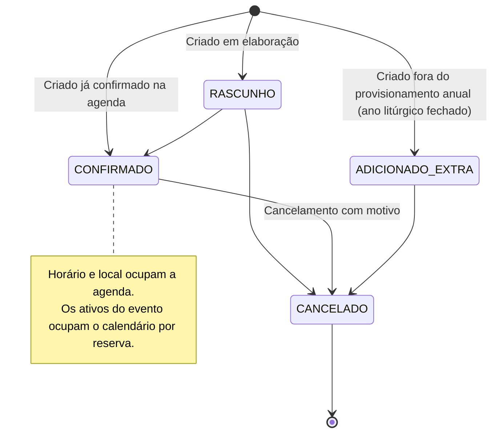
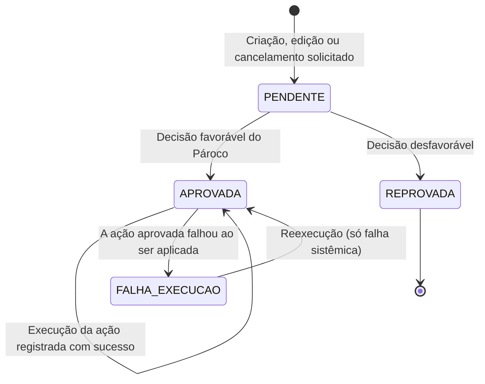
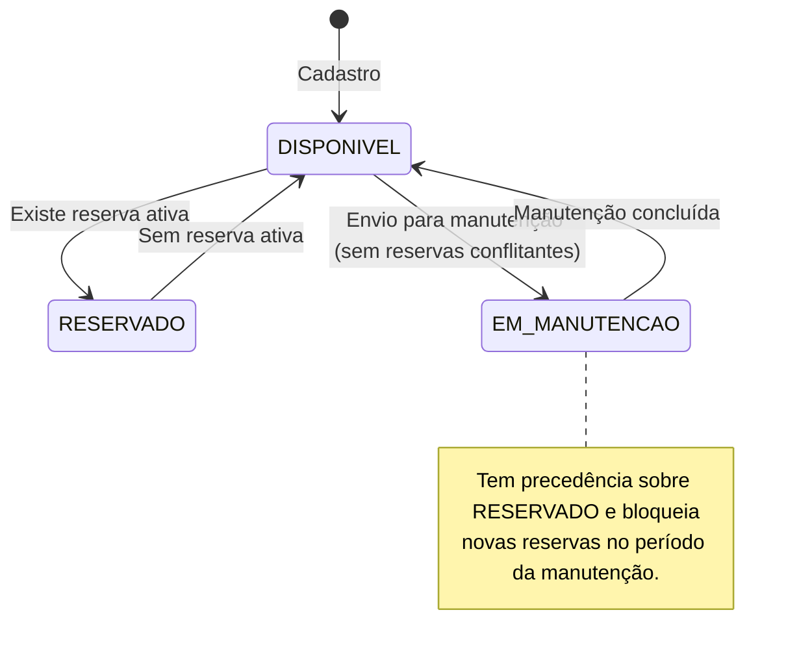
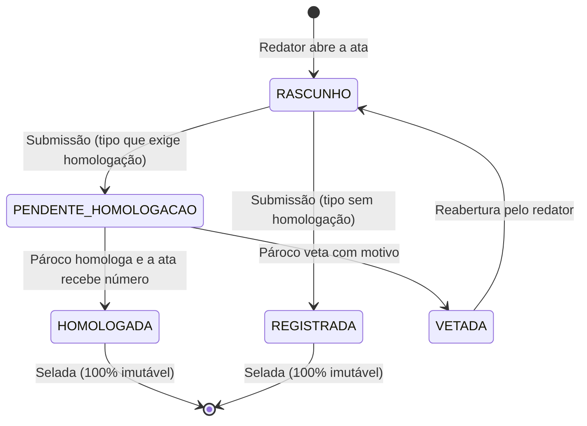

# ⚙️ Diagramas de Estados

Este documento mapeia os ciclos de vida das entidades centrais do **Projeto Paróquia** utilizando **Diagramas de Estado Mermaid**, especificando transições válidas, condições de guarda e eventos causadores.

---

## 1. Ciclo de Vida do Evento Paroquial (`EventoEntity`)

O status do evento (`EventoStatusInput`) tem quatro valores. A **aprovação pendente não é um status**: quando a mudança é desviada para a aprovação, o evento mantém o status oficial anterior e a resposta traz campos paralelos (aprovação pendente e tipo de solicitação pendente) até a decisão:

---

## 2. Ciclo de Vida da Solicitação de Aprovação (`Aprovacao`)

As solicitações tramitam de forma desacoplada do evento. Uma solicitação pendente é decidida pelo Pároco; depois de aprovada, a ação de negócio é executada e pode falhar:

A falha de execução é classificada como `NEGOCIO_CADASTRAL` ou `SISTEMICA_APLICACAO`; só a sistêmica admite reexecução. A decisão da aprovação-mãe é propagada às filhas.

---

## 3. Ciclo de Vida do Ativo Patrimonial (`AtivoPatrimonial`)

O status (`AtivoStatus`) reflete reservas e manutenção; a exclusão é lógica e não é um status:

A exclusão lógica é recusada com manutenção em aberto ou reservas futuras pendentes ou confirmadas.

---

## 4. Ciclo de Vida da Ata de Reunião (`AtaReuniao`)

Garante a fé pública eclesiástica e a rastreabilidade documental das atas dos conselhos e das demais reuniões pastorais. O caminho depende do tipo: os que exigem homologação passam pelo Pároco; os demais são registrados na submissão (`conselho.md`, seção 3):

Ata selada nunca é editada nem excluída: a correção é uma **ata retificadora**, nova ata em `RASCUNHO` ligada à original, com justificativa obrigatória.
