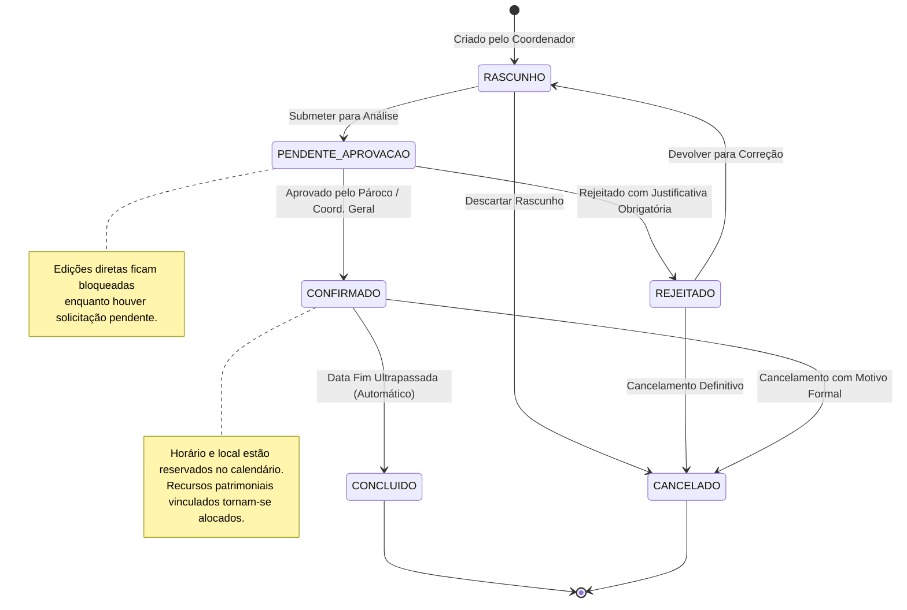
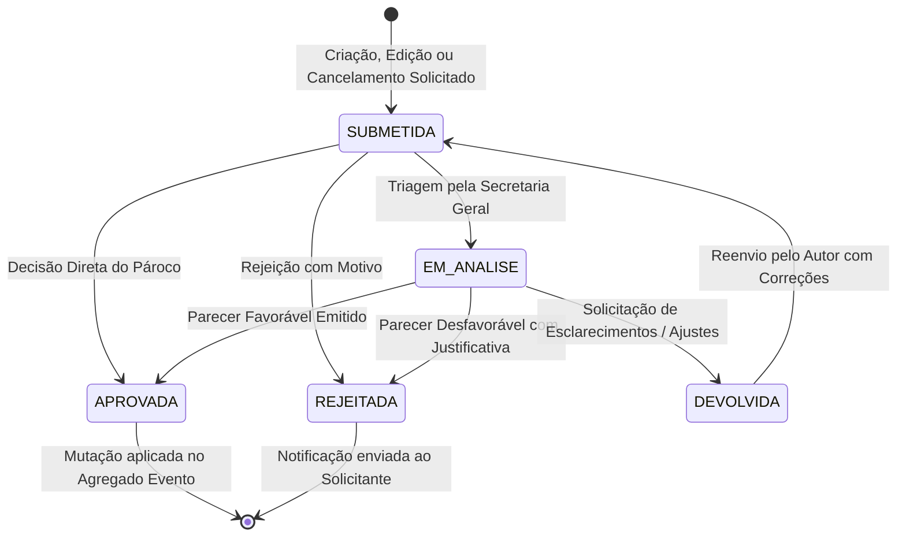
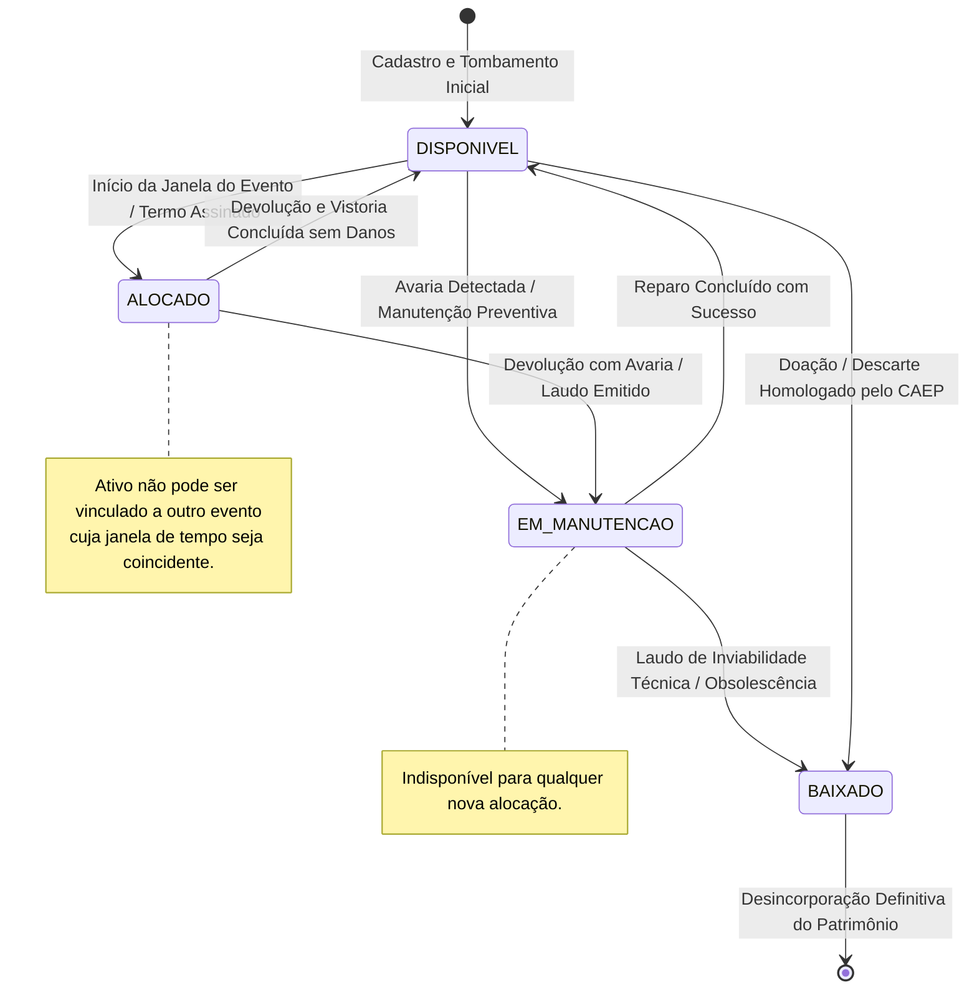
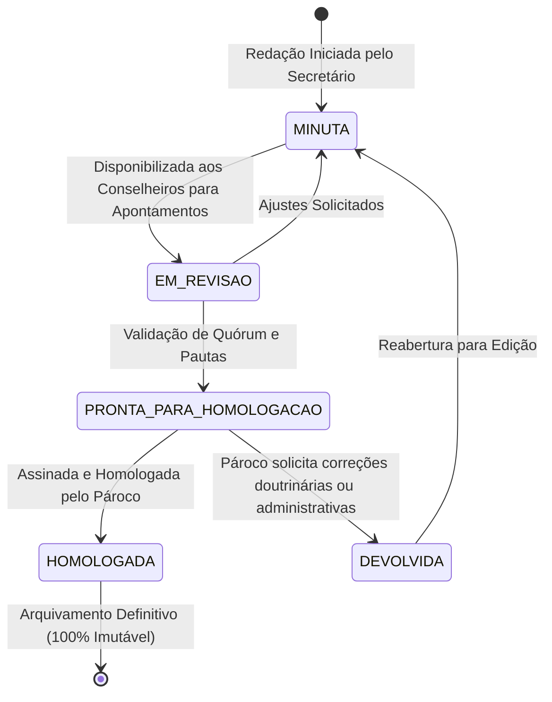

# ⚙️ Diagramas de Estados

Este documento mapeia os ciclos de vida das entidades centrais do **Projeto Paróquia** utilizando **Diagramas de Estado Mermaid**, especificando transições válidas, condições de guarda e eventos causadores.

---

## 1. Ciclo de Vida do Evento Paroquial (`Evento`)

O agregado `Evento` gerencia seu status através de uma máquina de estados finitos que impede mutações inválidas ou inconsistências no calendário:

---

## 2. Ciclo de Vida da Solicitação de Aprovação (`SolicitacaoAprovacao`)

As solicitações tramitam de forma desacoplada do evento, gerando um histórico rastreável de pareceres:

---

## 3. Ciclo de Vida do Ativo Patrimonial (`AtivoPatrimonial`)

Controla a integridade física e o agendamento dos bens pertencentes à paróquia ou comunidades:

---

## 4. Ciclo de Vida da Ata do Conselho Pastoral Paroquial (`AtaConselho`)

Garante a fé pública eclesiástica e rastreabilidade documental das decisões do CPC e CAEP:

