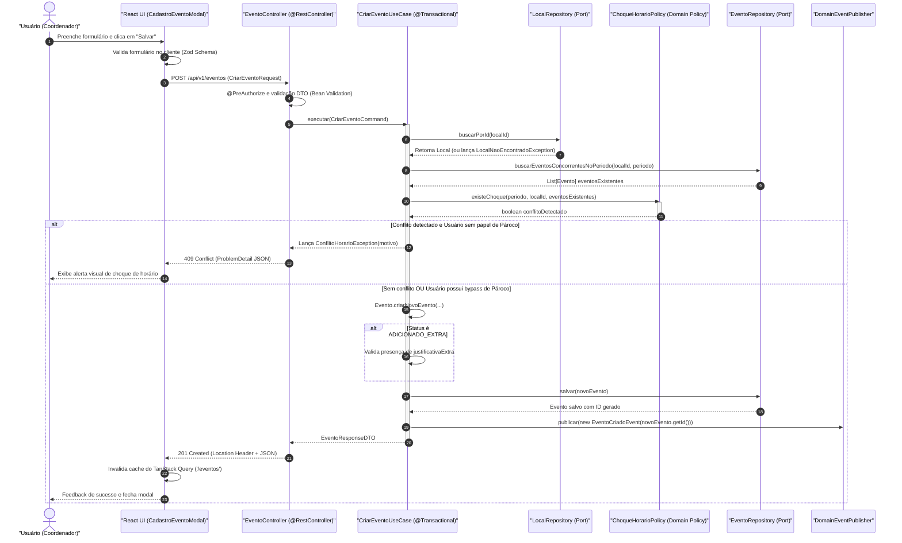
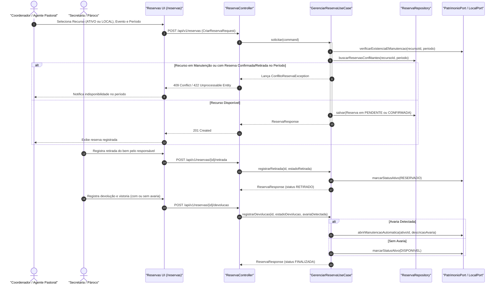
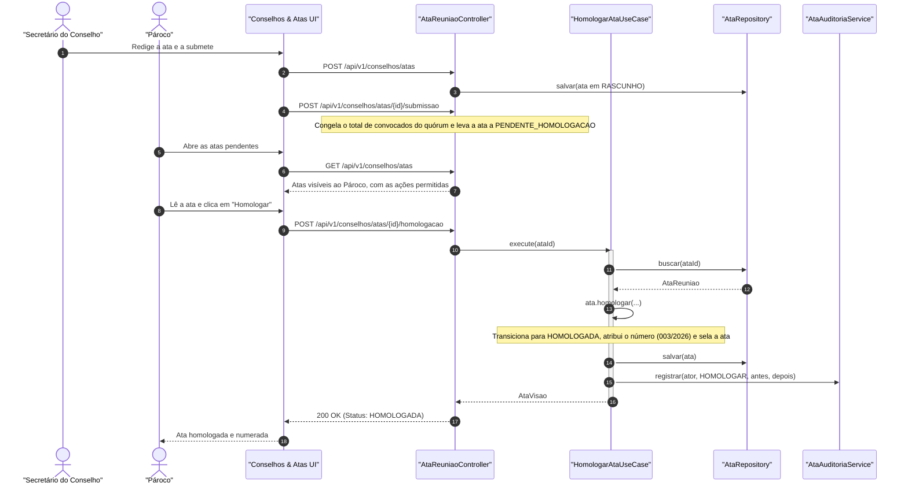

# 🔄 Diagramas de Sequência

Este documento apresenta os fluxos de interação temporal entre os atores do sistema, controllers, use cases de aplicação, domain policies puras e a camada de persistência através de **Diagramas de Sequência Mermaid**.

---

## 1. Fluxo de Criação de Evento com Validação de Choque e Fila de Aprovação

O diagrama abaixo descreve o fluxo completo de submissão de um evento, desde o clique no frontend até a verificação de sobreposição de horários e decisão de alçada:

---

## 2. Fluxo de Reserva de Local ou Ativo Patrimonial (`reserva`)

Este fluxo demonstra como o módulo `reserva` gerencia solicitações, checagem de conflitos/manutenção, retirada e devolução com conferência de avarias de ativos patrimoniais (som, projetores, paramentos) e locais:

---

## 3. Fluxo de Homologação de Ata de Reunião

Fluxo da governança eclesiástica de uma ata de tipo que exige homologação (por exemplo, a reunião do CPP). O redator é o secretário do conselho; a homologação é privativa do Pároco:

