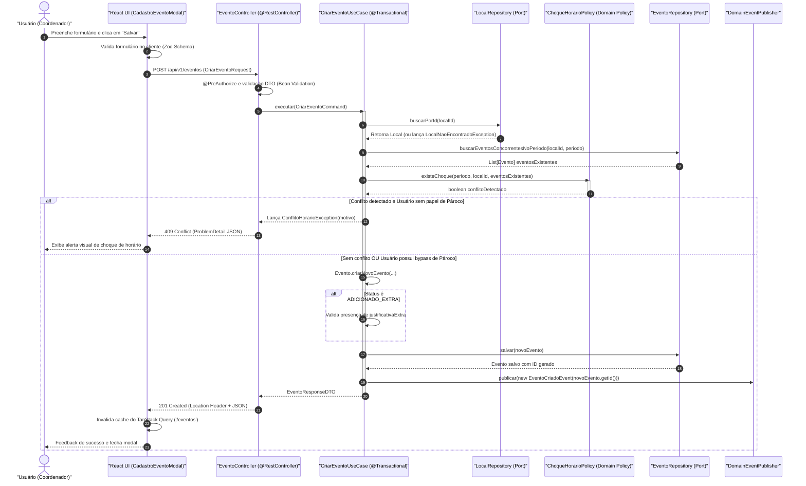
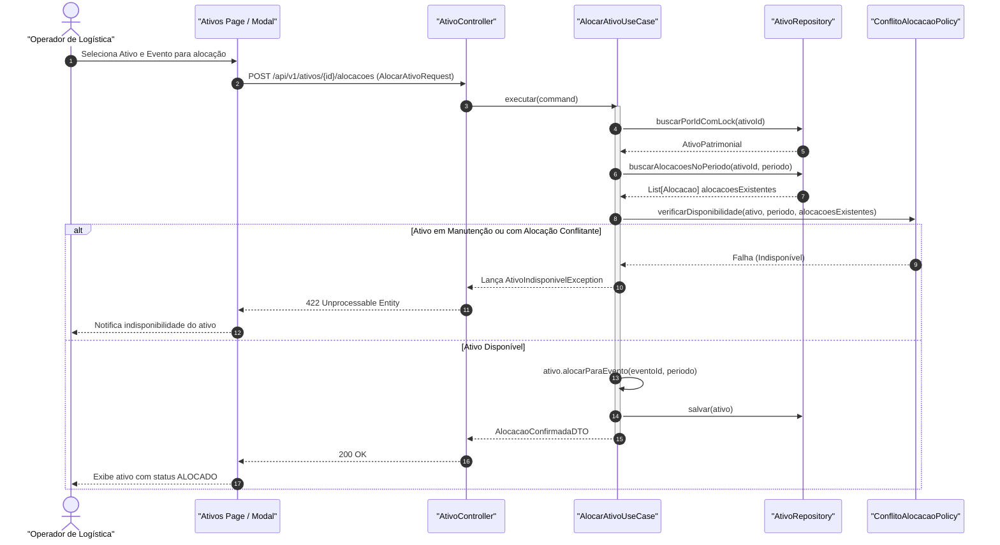
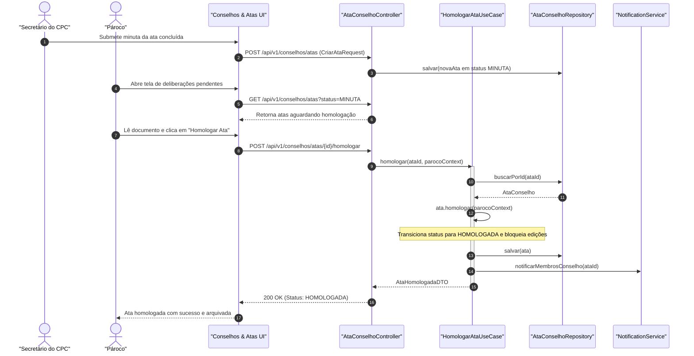

# 🔄 Diagramas de Sequência

Este documento apresenta os fluxos de interação temporal entre os atores do sistema, controllers, use cases de aplicação, domain policies puras e a camada de persistência através de **Diagramas de Sequência Mermaid**.

---

## 1. Fluxo de Criação de Evento com Validação de Choque e Fila de Aprovação

O diagrama abaixo descreve o fluxo completo de submissão de um evento, desde o clique no frontend até a verificação de sobreposição de horários e decisão de alçada:

---

## 2. Fluxo de Alocação Concorrente de Ativo Patrimonial

Este fluxo demonstra como a concorrência na alocação de itens patrimoniais (som, projetores, cadeiras) é tratada:

---

## 3. Fluxo de Homologação de Ata do Conselho Pastoral Paroquial (CPC)

Fluxo demonstrando a governança eclesiástica de atas do conselho paroquial:

