# 🧩 Padrões de Projeto (Design Patterns)

Este documento descreve os padrões de projeto táticos aplicados no **Projeto Paróquia**, detalhando a implementação prática dos padrões do **Domain-Driven Design (DDD)** e **Gang of Four (GoF)**, acompanhados do diagrama de classes dos agregados principais.

---

## 1. Diagrama de Classes dos Agregados Centrais

O modelo abaixo ilustra a relação entre os principais Agregados do sistema, seus Value Objects imutáveis e a desacoplação de regras de negócio em Domain Policies (Strategy Pattern) (é um modelo de referência: os identificadores tipados existem hoje em `AtaReuniaoId`, `AtivoPatrimonialId`, `AtivoManutencaoId`, `AssentoSacramentalId` e `ReservaId`; nos demais contextos o identificador é um UUID):

```mermaid
classDiagram
    class EventoId {
        +UUID value
    }

    class LocalId {
        +UUID value
    }

    class OrganizacaoId {
        +UUID value
    }

    class FielId {
        +UUID value
    }

    class Periodo {
        +Instant inicio
        +Instant fim
        +sobrepoe(Periodo outro) boolean
    }

    class EventoStatus {
        <<enumeration>>
        RASCUNHO
        PENDENTE_APROVACAO
        CONFIRMADO
        REJEITADO
        CANCELADO
        CONCLUIDO
    }

    class Evento {
        -EventoId id
        -String titulo
        -Periodo periodo
        -LocalId localId
        -OrganizacaoId organizacaoResponsavelId
        -EventoStatus status
        -String justificativaExtra
        +submeterParaAprovacao(AprovacaoEventoPolicy policy) void
        +confirmar(ParocoContext paroco) void
        +cancelar(String motivo) void
        +validarConflito(ChoqueHorarioPolicy policy, List outrosEventos) void
    }

    class ChoqueHorarioPolicy {
        <<interface>>
        +existeChoque(Periodo periodo, LocalId local, List existentes) boolean
    }

    class ChoqueHorarioPolicyImpl {
        -Duration intervaloTolerancia
        +existeChoque(Periodo periodo, LocalId local, List existentes) boolean
    }

    class AprovacaoEventoPolicy {
        <<interface>>
        +requerAprovacaoSuperior(Evento evento, UsuarioPerfil perfil) boolean
    }

    class AtivoPatrimonial {
        -UUID id
        -String numeroTombo
        -String nome
        -EstadoAtivo estado
        -LocalId localBaseId
        +alocarParaEvento(EventoId eventoId, Periodo periodo) void
        +devolver() void
        +registrarManutencao(String laudo) void
    }

    class Fiel {
        -FielId id
        -NomePessoa nome
        -CPF civilCpf
        -DadosSacramentais sacramentos
        -DadosVocacionais vocacao
        +registrarSacramento(TipoSacramento tipo, Instant data) void
    }

    class Membro {
        -UUID id
        -FielId fielId
        -OrganizacaoId organizacaoId
        -PapelMembro papel
        -Periodo mandato
        +isLiderancaAtiva() boolean
    }

    class Organizacao {
        -OrganizacaoId id
        -String nome
        -TipoOrganizacao tipo
        -UUID igrejaVinculoId
        +adicionarMembro(FielId fielId, PapelMembro papel) void
    }

    Evento --> EventoId : "possui"
    Evento --> Periodo : "possui"
    Evento --> LocalId : "alocado em"
    Evento --> OrganizacaoId : "gerido por"
    Evento --> EventoStatus : "estado"
    Evento ..> ChoqueHorarioPolicy : "valida conflito"
    Evento ..> AprovacaoEventoPolicy : "avalia aprovacao"
    ChoqueHorarioPolicy <|.. ChoqueHorarioPolicyImpl : "implementa"

    AtivoPatrimonial --> LocalId : "base"
    AtivoPatrimonial ..> EventoId : "alocado"

    Fiel --> FielId : "identificado por"
    Membro --> FielId : "refere-se a"
    Membro --> OrganizacaoId : "vinculado a"
    Organizacao --> OrganizacaoId : "identificado por"
```



---

## 2. Catálogo de Padrões DDD Tático

### 2.1. Domain Policy Pattern (Strategy Pura)

**O Problema:** Em sistemas complexos, classes de serviço (`*Service`) frequentemente se degeneram em estruturas procedurais inchadas com múltiplos encadeamentos de `if/else` ou `switch/case` para avaliar regras de desconto, choque de horários, juros ou alçadas de decisão.

**A Solução Adotada:**
- Todas as decisões de negócio variáveis são segregadas em interfaces `*Policy` e implementações concretas dentro de `domain/policy/`.
- **Isolamento e Zero-I/O:** Uma Policy no domínio **nunca** injeta repositórios, conexões de banco de dados ou APIs externas. O UseCase recupera os dados necessários e entrega à Policy apenas agregados, coleções ou snapshots imutáveis em memória.
- **Tell, Don't Ask:** A Policy avalia e retorna uma decisão, sem mutar diretamente os setters do agregado. O próprio agregado comanda sua mutação a partir da resposta da Policy:
  ```java
  // Exemplo no Domínio
  evento.validarConflito(choqueHorarioPolicy, eventosExistentesDoLocal);
  ```

---

### 2.2. Value Objects Imutáveis com `record` (Java 25)

Tipos primitivos genéricos (`String`, `UUID`, `Long`) são substituídos por identificadores e conceitos com alta semântica:

```java
public record Periodo(Instant inicio, Instant fim) {
    public Periodo {
        Objects.requireNonNull(inicio, "A data de início é obrigatória.");
        Objects.requireNonNull(fim, "A data de fim é obrigatória.");
        if (inicio.isAfter(fim)) {
            throw new PeriodoInvalidoException("A data de início não pode ser posterior ao fim.");
        }
    }

    public boolean sobrepoe(Periodo outro) {
        return !this.inicio.isAfter(outro.fim) && !outro.inicio.isAfter(this.fim);
    }
}
```

- **Autovalidação no Compact Constructor:** Garante que nenhum Value Object inválido seja criado no sistema.
- **Imutabilidade e Eficiência:** Records são imutáveis por padrão, gerando implementações seguras de `equals`, `hashCode` e `toString`.

---

### 2.3. Associação entre Agregados Exclusivamente por ID

Para garantir limites transacionais atômicos e evitar grafos gigantescos de navegação ORM em cascata:

- Agregados **nunca** mantêm referências diretas de objeto (como `@ManyToOne` com o objeto completo) para outros agregados no domínio.
- A associação é sempre efetuada por **identificador** (UUID ou Value Object identificador tipado, como `AtivoPatrimonialId`), nunca pelo objeto do outro agregado.
- **Invariante:** Cada transação no banco de dados modifica no máximo **1 agregado raiz**. Se a operação exigir sincronia com outro agregado, o desacoplamento é feito via **Domain Events**.

---

## 3. Catálogo de Padrões GoF

### 3.1. Factory Pattern & Construtores Semânticos
Agregados raiz não possuem construtores públicos desprovidos de invariantes. A criação é feita via métodos de fábrica com nome de negócio explícito:

```java
public final class Evento {
    // Fábrica semântica expressando a intenção de negócio
    public static Evento criarNovoEvento(
        String titulo,
        Periodo periodo,
        LocalId localId,
        OrganizacaoId orgId,
        String justificativaExtra
    ) {
        // Validação de invariantes antes da instanciação
        return new Evento(EventoId.gerar(), titulo, periodo, localId, orgId, EventoStatus.RASCUNHO, justificativaExtra);
    }
}
```

---

### 3.2. Observer Pattern via Domain Events
Ações de domínio que produzem efeitos colaterais em outros contextos (ex: notificação da secretaria, recálculo de métricas do dashboard, registro de auditoria) publicam eventos leves:

- **Evento:** `EventoCriadoEvent(EventoId id, Periodo periodo, LocalId localId, Instant ocorridoEm)`
- **Desacoplamento:** O agregador emite o evento; um listener assíncrono consome o evento sem prender a transação primária.

---

### 3.3. Sealed Hierarchies com Pattern Matching (Java 25)

Em substituição a enums rígidos ou hierarquias abertas, classes de decisão utilizam tipos selados (`sealed classes/interfaces`):

```java
public sealed interface DecisaoAprovacao permits Aprovada, Rejeitada, DevolvidaParaAjuste {
    record Aprovada(Instant aprovadaEm, String usuarioAprovador) implements DecisaoAprovacao {}
    record Rejeitada(Instant rejeitadaEm, String motivo, String usuarioRejeitador) implements DecisaoAprovacao {}
    record DevolvidaParaAjuste(Instant devolvidaEm, String instrucoes) implements DecisaoAprovacao {}
}
```

O consumo é feito com **Pattern Matching exaustivo** no `switch`, eliminando branches `default` artificiais e garantindo checagem em tempo de compilação quando um novo estado é introduzido.
